# Báo Cáo Nghiên Cứu Kỹ Thuật Phần Cứng: Hệ Thống Thu Thập Tín Hiệu sEMG 3 Kênh (`MCP6004` + `ESP32-S3`) Trên Nhánh `feat/afe-mcp6004-pcb`

- **Nhánh khảo sát (Git Branch)**: `feat/afe-mcp6004-pcb`
- **Commit Hash**: `df6332c56c1f7ed6fe0aebe8204fff8b213cc801` (`feat(hardware): complete 3-channel sEMG AFE design with MCP6004 and ESP32-S3`, Author: Mac Quang Khai, Date: `2026-11-01 22:49:00 +0700`)
- **Phiên bản công cụ EDA**: KiCad `10.0` (`kicad_sch` version `20260101`, `kicad_pcb` version `20260206`) & LTspice `26.1.1`
- **Phạm vi khảo sát**: Toàn bộ 24 file thuộc commit `df6332c56c1f7ed6fe0aebe8204fff8b213cc801`, bao gồm sơ đồ nguyên lý KiCad (`.kicad_sch`), file layout PCB (`.kicad_pcb`), cấu hình dự án/DRC (`.kicad_pro`), các bản sao lưu lịch sử chỉnh sửa PCB (`.mcp-backups`), file mô phỏng LTspice (`AFE_EMG_3ch.asc`), và tài liệu đặc tả (`README_AFE.md`, `EMG_Gesture_Recognition_Project_Brief.md`).

---

## 1. Tổng Quan Kiến Trúc & Lịch Sử Tiến Hóa Thiết Kế Trên Nhánh `feat/afe-mcp6004-pcb`

### 1.1. Cấu Trúc Nhánh & Danh Mục File Nguồn Chính Thống (Primary Sources)
Nhánh `feat/afe-mcp6004-pcb` được khởi tạo từ một root commit độc lập (`df6332c56c1f7ed6fe0aebe8204fff8b213cc801`) so với nhánh `main` (vốn chứa firmware/server/ML pipeline từ commit `fd46416` đến `23b560c`). Toàn bộ 24 file trên nhánh `feat/afe-mcp6004-pcb` tập trung hoàn toàn vào thiết kế phần cứng vòng đeo tay thu thập tín hiệu điện cơ bề mặt 3 kênh (**3-Channel Wearable Forearm sEMG Armband**):

| Phân loại | Đường dẫn File trong Repo | Số dòng | Nội dung kỹ thuật chính |
| :--- | :--- | :---: | :--- |
| **Tài liệu định hướng** | [`EMG_Gesture_Recognition_Project_Brief.md`](file:///c:/Users/Admin/Documents/IoT/EMG_Gesture_Recognition_Project_Brief.md) | 105 | Đặc tả bài toán nhận diện 4 cử chỉ tay (`Rest`, `Fist`, `Open hand`, `Pinch`) từ 3 cơ cẳng tay (`FCR`, `EDC`, `Brachioradialis`) + điện cực tham chiếu tại mỏm khuỷu (`Olecranon`). |
| **Đặc tả & Mô phỏng AFE** | [`README_AFE.md`](file:///c:/Users/Admin/Documents/IoT/README_AFE.md) | 61 | Tóm tắt kiến trúc mạch AFE 3 kênh 3.3V, kết quả mô phỏng LTspice, BOM mô phỏng và thiết kế bộ lọc số Biquad Notch 50 Hz trên MCU. |
| **File LTspice** | [`AFE_EMG_3ch.asc`](file:///c:/Users/Admin/Documents/IoT/AFE_EMG_3ch.asc) | 630 | Netlist & sơ đồ mô phỏng LTspice 26.1.1 của toàn bộ mạch 3-CH sEMG AFE + Shared Active DRL + Virtual Ground 1.65V. |
| **Cấu hình KiCad & DRC** | [`hardware/EMG_Armband_3CH.kicad_pro`](file:///c:/Users/Admin/Documents/IoT/hardware/EMG_Armband_3CH.kicad_pro) | 684 | Thiết lập dự án KiCad, luật thiết kế DRC (`min_track_width` 0.2 mm, `min_via` 0.5/0.3 mm, netclass `Default`). |
| **Root Schematic** | [`hardware/EMG_Armband_3CH.kicad_sch`](file:///c:/Users/Admin/Documents/IoT/hardware/EMG_Armband_3CH.kicad_sch) | 61 | Sơ đồ phân cấp gốc (Hierarchical Root Sheet) liên kết 3 trang mạch chức năng. |
| **Sub-sheet 1: Nguồn** | [`hardware/Power_Supply.kicad_sch`](file:///c:/Users/Admin/Documents/IoT/hardware/Power_Supply.kicad_sch) | 4,487 | Mạch nguồn USB-C 16P (`J1`), sạc pin Li-Po `TP4056` (`U1`), công tắc nguồn `SW1`, và LDO `AP2112K-3.3` (`U2`). |
| **Sub-sheet 2: Vi điều khiển** | [`hardware/MCU_ESP32.kicad_sch`](file:///c:/Users/Admin/Documents/IoT/hardware/MCU_ESP32.kicad_sch) | 3,447 | Mạch vi điều khiển `ESP32-S3-WROOM-1` (`U3`), giao tiếp USB Native, nút nhấn `RESET`/`BOOT`, và bộ lọc RC đầu vào SAR ADC 3 kênh. |
| **Sub-sheet 3: AFE 3 Kênh** | [`hardware/AFE_3CH_AD8232.kicad_sch`](file:///c:/Users/Admin/Documents/IoT/hardware/AFE_3CH_AD8232.kicad_sch) | 2,754 | Mạch Analog Front-End 3 kênh sEMG dùng 5 IC Quad Op-Amp `MCP6004` (`U4`–`U8`), tạo áp chuẩn `VREF` 1.65V và mạch `Active DRL`. |
| **File PCB Layout** | [`hardware/EMG_Armband_3CH.kicad_pcb`](file:///c:/Users/Admin/Documents/IoT/hardware/EMG_Armband_3CH.kicad_pcb) | 20,284 | File PCB 2 lớp đồng (`F.Cu`, `B.Cu`), đã import đầy đủ 113 footprints linh kiện và toàn bộ netlist kết nối chân. |
| **Lịch sử Backup PCB** | `hardware/.mcp-backups/*.kicad_pcb.*` | 7 files | Các bản snapshot tự động ghi lại quá trình chuyển đổi từ module gắn ngoài sang mạch AFE rời dùng `MCP6004`. |
| **Bản vẽ xuất hình** | `hardware/*.svg`, `hardware/Power_Supply.png` | 7 files | Các bản xuất đồ họa sơ đồ nguyên lý của từng trang mạch. |

---

### 1.2. Ba Giai Đoạn Tiến Hóa Của Thiết Kế Phần Cứng
Qua đối chiếu giữa tài liệu Brief, các bản sao lưu trong `hardware/.mcp-backups/`, file mô phỏng `AFE_EMG_3ch.asc` và sơ đồ KiCad cuối cùng, thiết kế đã trải qua 3 bước tiến hóa kỹ thuật rõ rệt:

1. **Giai đoạn 1 — Ý tưởng ban đầu & thử nghiệm hướng module (`EMG_Gesture_Recognition_Project_Brief.md` & `.mcp-backups`)**:
   - Tài liệu [`EMG_Gesture_Recognition_Project_Brief.md`](file:///c:/Users/Admin/Documents/IoT/EMG_Gesture_Recognition_Project_Brief.md#L13-L56) đề xuất hệ thống 3 kênh đặt tại 3 nhóm cơ cẳng tay (**Kênh 1**: *Flexor Carpi Radialis - FCR*; **Kênh 2**: *Extensor Digitorum Communis - EDC*; **Kênh 3**: *Brachioradialis*; **REF**: *Olecranon* - mỏm khuỷu tay) với dải thông mục tiêu $20\text{ Hz} - 450\text{ Hz}$, tốc độ lấy mẫu $f_s \ge 1000\text{ Hz}$ và tổng độ lợi $G \approx 500 - 1000\text{ V/V}$.
   - Trong bản backup PCB đầu tiên [`hardware/.mcp-backups/EMG_Armband_3CH.kicad_pcb.20261026-173801-832`](file:///c:/Users/Admin/Documents/IoT/hardware/.mcp-backups/EMG_Armband_3CH.kicad_pcb.20261026-173801-832) (8,633 dòng, 40 footprints), phần AFE ban đầu sử dụng 3 cụm header nối module breakout `AD8232` (`J_MOD1`, `J_MOD2`, `J_MOD3` kèm tụ `C20`, `C21`, `C22`). Đây chính là lý do file schematic trang 4 vẫn giữ tên lịch sử là `AFE_3CH_AD8232.kicad_sch`.
   - Từ mốc `2026-11-01 22:10:54` đến `22:11:10` (các file backup [`20261101-221054-931`](file:///c:/Users/Admin/Documents/IoT/hardware/.mcp-backups/EMG_Armband_3CH.kicad_pcb.20261101-221054-931) $\to$ [`20261101-221110-368`](file:///c:/Users/Admin/Documents/IoT/hardware/.mcp-backups/EMG_Armband_3CH.kicad_pcb.20261101-221110-368)), toàn bộ 3 module header `J_MOD1..3` và `C20..22` đã được xóa bỏ để thay bằng mạch AFE tích hợp trực tiếp trên PCB.

2. **Giai đoạn 2 — Thiết kế & Kiểm chứng cấu trúc CCIA + Active DRL trên LTspice (`AFE_EMG_3ch.asc` & `README_AFE.md`)**:
   - Thay vì dùng IC Instrumentation Amplifier đắt tiền hoặc module `AD8232` (vốn tối ưu cho băng thông hẹp của ECG thay vì băng thông $20-500\text{ Hz}$ của sEMG), thiết kế chuyển sang kiến trúc **Capacitively-Coupled Instrumentation Amplifier (CCIA)** nuôi nguồn đơn $+3.3\text{ V}$ kết hợp **Input Unity-Gain Buffers**, **Non-Inverting Gain + Passive HPF**, **2nd-Order Sallen-Key Butterworth LPF**, và **Shared Active Driven Right Leg (DRL)** ([`AFE_EMG_3ch.asc`](file:///c:/Users/Admin/Documents/IoT/AFE_EMG_3ch.asc#L1-L630)).
   - Lý do kỹ thuật cốt lõi khi chọn tổng độ lợi phần cứng **$\approx 113\times$ ($41.1\text{ dB}$)** thay vì $500-1000\times$: Với nguồn đơn $+3.3\text{ V}$ (biên độ xoay cực đại quanh điểm tựa $V_{\text{REF}} = 1.65\text{ V}$ là $\pm 1.65\text{ V}$), khi cơ co mạnh (biên độ sEMG đầu vào đạt $\pm 5\text{ mV}_{\text{peak}}$ kèm nhiễu chuyển động tần số thấp), độ lợi $1000\times$ sẽ làm bão hòa (clipping) hoàn toàn tầng khuếch đại. Với $G \approx 113\times$, tín hiệu $\pm 5\text{ mV}_{\text{peak}}$ được khuếch đại lên $\pm 565\text{ mV}_{\text{peak}}$ quanh $1.65\text{ V}$, giữ khoảng dự trữ (headroom) $\sim 3\times$ chống bão hòa, đồng thời kết hợp hoàn hảo với ADC 12-bit của `ESP32-S3` ($\text{LSB} \approx 0.8\text{ mV}$ tại đầu ra AFE, tương đương độ phân giải quy đổi về đầu vào $\text{RTI} \approx 7.1\text{ }\mu\text{V}/\text{LSB}$).

3. **Giai đoạn 3 — Hiện thực hóa trên KiCad 10.0 với 5× IC Quad Op-Amp `MCP6004` (`hardware/*.kicad_sch` & `.kicad_pcb`)**:
   - Toàn bộ cấu trúc mạch và giá trị linh kiện thụ động ($R, C$) từ file LTspice [`AFE_EMG_3ch.asc`](file:///c:/Users/Admin/Documents/IoT/AFE_EMG_3ch.asc) được chuyển nguyên vẹn sang sơ đồ nguyên lý [`hardware/AFE_3CH_AD8232.kicad_sch`](file:///c:/Users/Admin/Documents/IoT/hardware/AFE_3CH_AD8232.kicad_sch).
   - Mã linh kiện Op-Amp được chuyển từ `AD8605`/`AD8608ARZ` (dùng trong mô phỏng LTspice) sang **5× `MCP6004`** (`U4`, `U5`, `U6`, `U7`, `U8` — đóng gói `SOIC-14`) để tối ưu chi phí và tính sẵn có của linh kiện khi chế tạo PCB thực tế.

---

## 2. Kiến Trúc Phân Cấp Sơ Đồ Nguyên Lý (Hierarchical Schematic Architecture)

Sơ đồ gốc [`hardware/EMG_Armband_3CH.kicad_sch`](file:///c:/Users/Admin/Documents/IoT/hardware/EMG_Armband_3CH.kicad_sch#L1-L61) (`uuid: 3262dff6-21d8-46ae-b076-e8c18cfd40c4`, khổ giấy `A4`) tổ chức hệ thống thành 3 trang sơ đồ con (Hierarchical Sheets) giao tiếp với nhau thông qua hệ thống **Global Labels**:

```mermaid
flowchart LR
    subgraph Sheet1["Page 2: Power_Supply.kicad_sch"]
        J1["J1: USB-C 16P"] -->|VBUS 5V| U1["U1: TP4056 (Ichg = 500mA)"]
        J2["J2: Li-Po Battery (JST-PH 2P)"] <-->|VBAT| U1
        U1 -->|VBAT| SW1["SW1: Master ON/OFF (SPDT)"]
        SW1 -->|VSW| U2["U2: AP2112K-3.3 LDO"]
    end

    subgraph Sheet3["Page 4: AFE_3CH_AD8232.kicad_sch (5x MCP6004)"]
        J3["J3: 8-Pin Electrode Header<br/>(EN1/EP1, EN2/EP2, EN3/EP3, DRL, VREF)"]
        VREF_GEN["U8A: VREF 1.65V Buffer"]
        DRL_BLK["U8B: Shared Active DRL<br/>(6x 100k Summing + Integrator)"]
        CH1["CH1 Chain (U4A-D, U7A)"]
        CH2["CH2 Chain (U5A-D, U7B)"]
        CH3["CH3 Chain (U6A-D, U7C)"]
        J3 -->|EN1, EP1| CH1
        J3 -->|EN2, EP2| CH2
        J3 -->|EN3, EP3| CH3
        CH1 & CH2 & CH3 -->|BUFN1..3, BUFP1..3| DRL_BLK
        DRL_BLK -->|DRL (via R69 390k)| J3
        VREF_GEN -->|VREF 1.65V| J3
    end

    subgraph Sheet2["Page 3: MCU_ESP32.kicad_sch"]
        RC_ADC["RC Anti-Kickback Filters<br/>(R14-R16: 100Ω, C13-C15: 1nF)"]
        U3["U3: ESP32-S3-WROOM-1<br/>(IO4/ADC1_CH3, IO5/ADC1_CH4, IO6/ADC1_CH5)"]
        RC_ADC -->|ADC_CH1..3| U3
    end

    J1 <-->|USB_DP, USB_DN| U3
    U2 -->|"+3V3 & GND"| Sheet3
    U2 -->|"+3V3 & GND"| Sheet2
    CH1 -->|EMG_CH1| RC_ADC
    CH2 -->|EMG_CH2| RC_ADC
    CH3 -->|EMG_CH3| RC_ADC
```

### Danh sách các Global Nets liên kết giữa 3 Sheet
Đối chiếu từ [`Power_Supply.kicad_sch`](file:///c:/Users/Admin/Documents/IoT/hardware/Power_Supply.kicad_sch), [`MCU_ESP32.kicad_sch`](file:///c:/Users/Admin/Documents/IoT/hardware/MCU_ESP32.kicad_sch), và [`AFE_3CH_AD8232.kicad_sch`](file:///c:/Users/Admin/Documents/IoT/hardware/AFE_3CH_AD8232.kicad_sch):
1. **`VBUS`**: Nguồn $+5\text{ V}$ từ cổng USB Type-C `J1` cấp cho IC sạc `TP4056` (`U1`).
2. **`+3V3`**: Đường nguồn $+3.3\text{ V}$ ổn áp từ LDO `AP2112K-3.3` (`U2`) cấp chung cho cả khối vi điều khiển `ESP32-S3-WROOM-1` (`U3`) và 5 IC `MCP6004` (`U4`–`U8`) cùng cầu phân áp chuẩn `R60`/`R61`.
3. **`GND`**: Mạng mass chung toàn mạch (thiết kế hiện tại hợp nhất `GND` giữa nguồn, MCU và AFE ngay trên schematic).
4. **`USB_DP`, `USB_DN`**: Cặp tín hiệu vi sai USB 2.0 Full-Speed nối trực tiếp từ `J1` (`A6/B6`, `A7/B7`) vào bộ điều khiển USB OTG / Serial-JTAG nội của `ESP32-S3` (`IO20`, `IO19`).
5. **`EMG_CH1`, `EMG_CH2`, `EMG_CH3`**: 3 ngõ ra analog đã khuếch đại và lọc thông dải từ tầng Sallen-Key LPF (`U7A`, `U7B`, `U7C`) đưa sang bộ lọc RC trước chân ADC của `ESP32-S3`.

---

## 3. Phân Tích Chi Tiết Khối Nguồn & Quản Lý Pin (`Power_Supply.kicad_sch`)

File nguồn: [`hardware/Power_Supply.kicad_sch`](file:///c:/Users/Admin/Documents/IoT/hardware/Power_Supply.kicad_sch#L1-L4487) (`uuid: bbb0a053-7f27-4667-acbb-a5c8c109d0a0`, Page 2). Tổng số linh kiện vật lý: **16 linh kiện** (không tính 3 cờ `#FLG01`–`#FLG03` `PWR_FLAG` tại dòng `L3668–L3898`).

### 3.1. Giao Tiếp USB Type-C (`J1`) & Cấu Hình Sink 5V (`R1`, `R2`, `C1`)
- **Linh kiện chính**: `J1` (`USB_C_16P`, footprint `Connector_USB:USB_C_Receptacle_HRO_TYPE-C-31-M-12`, [`Power_Supply.kicad_sch:2158-2281`](file:///c:/Users/Admin/Documents/IoT/hardware/Power_Supply.kicad_sch#L2158-L2281), [`EMG_Armband_3CH.kicad_pcb:7491`](file:///c:/Users/Admin/Documents/IoT/hardware/EMG_Armband_3CH.kicad_pcb#L7491)).
- **Sơ đồ đấu nối chân `J1`** ([`EMG_Armband_3CH.kicad_pcb:7491-7640`](file:///c:/Users/Admin/Documents/IoT/hardware/EMG_Armband_3CH.kicad_pcb#L7491-L7640)):
  - `A4`, `A9`, `B4`, `B9` $\to$ `VBUS`
  - `A1`, `A12`, `B1`, `B12`, và 4 chân vỏ `SH` (Shield) $\to$ `GND`
  - `A5` $\to$ `CC1`; `B5` $\to$ `CC2`
  - `A6`, `B6` $\to$ `USB_DP`; `A7`, `B7` $\to$ `USB_DN` (nối song song 2 mặt A/B hỗ trợ cắm đảo chiều cáp USB-C)
  - `A8` (`SBU1`), `B8` (`SBU2`) $\to$ Đánh dấu `no_connect` ([`Power_Supply.kicad_sch:4348-4355`](file:///c:/Users/Admin/Documents/IoT/hardware/Power_Supply.kicad_sch#L4348-L4355)).
- **Điện trở định danh USB-C UFP/Sink ($R_d = 5.1\text{ k}\Omega$)**:
  - `R1` = $5.1\text{ k}\Omega$ (`R_0805_2012Metric`, [`Power_Supply.kicad_sch:2282-2360`](file:///c:/Users/Admin/Documents/IoT/hardware/Power_Supply.kicad_sch#L2282-L2360)): Nối từ `CC1` xuống `GND`.
  - `R2` = $5.1\text{ k}\Omega$ (`R_0805_2012Metric`, [`Power_Supply.kicad_sch:2361-2439`](file:///c:/Users/Admin/Documents/IoT/hardware/Power_Supply.kicad_sch#L2361-L2439)): Nối từ `CC2` xuống `GND`.
  - *Ý nghĩa kỹ thuật*: Việc tách riêng 2 điện trở $5.1\text{ k}\Omega$ độc lập cho `CC1` và `CC2` tuân thủ đúng chuẩn USB Type-C Specification cho thiết bị thụ động (Sink), đảm bảo bộ cấp nguồn USB-C PD (như sạc laptop/điện thoại dùng cáp C-to-C) nhận diện được thiết bị và xuất nguồn $+5\text{ V}$ trên `VBUS`.
- **Tụ lọc nguồn đầu vào `VBUS`**:
  - `C1` = $10\text{ }\mu\text{F}$ (`C_0805_2012Metric`, [`Power_Supply.kicad_sch:2440-2520`](file:///c:/Users/Admin/Documents/IoT/hardware/Power_Supply.kicad_sch#L2440-L2520)): Nối giữa `VBUS` và `GND` nhằm dập xung quá độ khi cắm cáp USB và lọc nguồn đầu vào cho `U1`.

### 3.2. Mạch Sạc Pin Li-Po Tuyến Tính `TP4056` (`U1`)
- **IC sạc**: `U1` (`TP4056`, symbol `Battery_Management:TP4056-42-ESOP8`, footprint `Package_SO:SOIC-8-1EP_3.9x4.9mm_P1.27mm_EP2.41x3.3mm`, [`Power_Supply.kicad_sch:2521-2620`](file:///c:/Users/Admin/Documents/IoT/hardware/Power_Supply.kicad_sch#L2521-L2620), [`EMG_Armband_3CH.kicad_pcb:6952`](file:///c:/Users/Admin/Documents/IoT/hardware/EMG_Armband_3CH.kicad_pcb#L6952)).
- **Kết nối chân `U1`**:
  - Chân `4` (`VCC`) & Chân `8` (`CE` - Chip Enable) $\to$ `VBUS` (tự động kích hoạt sạc khi có áp `VBUS`).
  - Chân `1` (`TEMP`), Chân `3` (`GND`), và Chân `9` (`EP` - Exposed Thermal Pad) $\to$ `GND` (vô hiệu hóa chức năng đo nhiệt NTC bằng cách nối `TEMP` xuống `GND`, đồng thời thoát nhiệt qua pad bụng `EP`).
  - Chân `2` (`PROG`) $\to$ `TP_PROG` $\to$ nối qua điện trở `R3` = $2.4\text{ k}\Omega$ (`R_0805_2012Metric`, [`Power_Supply.kicad_sch:2621-2699`](file:///c:/Users/Admin/Documents/IoT/hardware/Power_Supply.kicad_sch#L2621-L2699)) xuống `GND`.
  - Chân `5` (`BAT`) $\to$ `VBAT`.
  - Chân `7` (`~{CHRG}`) $\to$ `NET_CHRG` (cực thu hở kéo xuống thấp khi đang sạc).
  - Chân `6` (`~{STDBY}`) $\to$ `NET_STDBY` (cực thu hở kéo xuống thấp khi sạc đầy $4.2\text{ V}$).
- **Tính toán dòng sạc cài đặt ($I_{\text{CHG}}$)**:
  Theo datasheet `TP4056`, dòng sạc hằng dòng (Constant Current) được xác định bởi điện trở $R_{\text{PROG}}$ (`R3`):
  $$I_{\text{CHG}} = \frac{1200\text{ V}}{R_3} = \frac{1200\text{ V}}{2400\text{ }\Omega} = 0.5\text{ A} = 500\text{ mA}$$
  Mức dòng sạc $500\text{ mA}$ an toàn cho các cell Li-Po dung lượng $500\text{ mAh} - 1000\text{ mAh}$ ($\le 1\text{C}$) dùng trên vòng đeo tay và giảm công suất tiêu tán nhiệt trên vỏ `ESOP-8` ($P_D \approx (5.0\text{ V} - 3.7\text{ V}) \times 0.5\text{ A} = 0.65\text{ W}$).
- **Mạch LED báo trạng thái sạc (`D1`, `D2`, `R4`, `R5`)**:
  - **Đang sạc (`RED_CHRG`)**: `VBUS` $\to$ `R4` ($1\text{ k}\Omega$, [`Power_Supply.kicad_sch:2700-2778`](file:///c:/Users/Admin/Documents/IoT/hardware/Power_Supply.kicad_sch#L2700-L2778)) $\to$ net `LED_CHRG_A` (Anode Pin 2) $\to$ `D1` (`LED_0805_2012Metric`, [`Power_Supply.kicad_sch:2779-2857`](file:///c:/Users/Admin/Documents/IoT/hardware/Power_Supply.kicad_sch#L2779-L2857)) $\to$ net `NET_CHRG` (Cathode Pin 1). Dòng qua LED đỏ: $I_{\text{D1}} \approx \frac{5\text{ V} - 2.0\text{ V}}{1\text{ k}\Omega} \approx 3.0\text{ mA}$.
  - **Sạc đầy (`GREEN_STDBY`)**: `VBUS` $\to$ `R5` ($1\text{ k}\Omega$, [`Power_Supply.kicad_sch:2858-2936`](file:///c:/Users/Admin/Documents/IoT/hardware/Power_Supply.kicad_sch#L2858-L2936)) $\to$ net `LED_STDBY_A` (Anode Pin 2) $\to$ `D2` (`LED_0805_2012Metric`, [`Power_Supply.kicad_sch:2937-3015`](file:///c:/Users/Admin/Documents/IoT/hardware/Power_Supply.kicad_sch#L2937-L3015)) $\to$ net `NET_STDBY` (Cathode Pin 1).

### 3.3. Kết Nối Pin (`J2`), Công Tắc Nguồn (`SW1`) & Bộ Ổn Áp Tuyến Tính LDO `AP2112K-3.3` (`U2`)
- **Đầu nối Pin Li-Po**: `J2` (`BAT_IN`, footprint `Connector_JST:JST_PH_B2B-PH-K_1x02_P2.00mm_Vertical`, [`Power_Supply.kicad_sch:3097-3175`](file:///c:/Users/Admin/Documents/IoT/hardware/Power_Supply.kicad_sch#L3097-L3175)), với Chân `1` = `VBAT`, Chân `2` = `GND`, đi kèm tụ lọc `C2` = $10\text{ }\mu\text{F}$ (`C_0805_2012Metric`, [`Power_Supply.kicad_sch:3016-3096`](file:///c:/Users/Admin/Documents/IoT/hardware/Power_Supply.kicad_sch#L3016-L3096)).
- **Công tắc nguồn tổng**: `SW1` (`ON/OFF`, `Button_Switch_SMD:SW_SPDT_PCM12`, [`Power_Supply.kicad_sch:3176-3257`](file:///c:/Users/Admin/Documents/IoT/hardware/Power_Supply.kicad_sch#L3176-L3257)), ngắt/đóng đường `VBAT` (Chân 1) sang đường `VSW` (Chân 2), Chân 3 bỏ trống (`no_connect` tại `L4344-4347`).
- **Bộ ổn áp LDO 3.3V nhiễu thấp**: `U2` (`AP2112K-3.3`, đóng gói `Package_TO_SOT_SMD:SOT-23-5`, [`Power_Supply.kicad_sch:3258-3347`](file:///c:/Users/Admin/Documents/IoT/hardware/Power_Supply.kicad_sch#L3258-L3347), [`EMG_Armband_3CH.kicad_pcb:11444`](file:///c:/Users/Admin/Documents/IoT/hardware/EMG_Armband_3CH.kicad_pcb#L11444)):
  - Chân `1` (`VIN`) và Chân `3` (`EN`) nối chung vào `VSW`.
  - Chân `2` (`GND`) nối `GND`.
  - Chân `4` (`NC`) đánh dấu `no_connect` (`L4340-4343`).
  - Chân `5` (`VOUT`) xuất nguồn `+3V3` (dòng định mức tối đa $600\text{ mA}$, sụt áp dropout thấp $\sim 250\text{ mV}$, PSRR $\sim 65\text{ dB}$, đáp ứng tốt dòng đỉnh Wi-Fi/BLE của `ESP32-S3` và nuôi mạch analog).
  - Tụ lọc đầu vào LDO: `C3` = $4.7\text{ }\mu\text{F}$ (`VSW` $\to$ `GND`, `C_0805_2012Metric`, [`Power_Supply.kicad_sch:3348-3428`](file:///c:/Users/Admin/Documents/IoT/hardware/Power_Supply.kicad_sch#L3348-L3428)).
  - Tụ lọc đầu ra LDO: `C4` = $10\text{ }\mu\text{F}$ (`+3V3` $\to$ `GND`, `C_0805_2012Metric`, [`Power_Supply.kicad_sch:3429-3509`](file:///c:/Users/Admin/Documents/IoT/hardware/Power_Supply.kicad_sch#L3429-L3509)).
- **LED báo nguồn `+3V3`**: `R6` = $1\text{ k}\Omega$ (`+3V3` $\to$ `LED_PWR_A`, [`Power_Supply.kicad_sch:3510-3588`](file:///c:/Users/Admin/Documents/IoT/hardware/Power_Supply.kicad_sch#L3510-L3588)) nối tiếp với `D3` (`BLUE_3V3`, `LED_0805_2012Metric`, [`Power_Supply.kicad_sch:3589-3667`](file:///c:/Users/Admin/Documents/IoT/hardware/Power_Supply.kicad_sch#L3589-L3667)) xuống `GND`.

---

## 4. Phân Tích Chi Tiết Khối Vi Điều Khiển & Giao Tiếp ADC (`MCU_ESP32.kicad_sch`)

File nguồn: [`hardware/MCU_ESP32.kicad_sch`](file:///c:/Users/Admin/Documents/IoT/hardware/MCU_ESP32.kicad_sch#L1-L3447) (`uuid: 1af7a8b4-9820-4530-8dc3-403a0c310b88`, Page 3). Tổng số linh kiện vật lý: **15 linh kiện**.

### 4.1. Sơ Đồ Chân & Cấu Hình Phần Cứng `ESP32-S3-WROOM-1` (`U3`)
- **Module**: `U3` (`RF_Module:ESP32-S3-WROOM-1`, [`MCU_ESP32.kicad_sch:1531-1726`](file:///c:/Users/Admin/Documents/IoT/hardware/MCU_ESP32.kicad_sch#L1531-L1726), [`EMG_Armband_3CH.kicad_pcb:532`](file:///c:/Users/Admin/Documents/IoT/hardware/EMG_Armband_3CH.kicad_pcb#L532)).
- **Bảng ánh xạ chân `U3` đang sử dụng**:

| Số chân `U3` | Tên chân (`ESP32-S3`) | Tên Net trên Schematic | Chức năng trong hệ thống | Linh kiện ngoại vi đi kèm |
| :---: | :--- | :--- | :--- | :--- |
| `1`, `40`, `41` | `GND` + Thermal Pad | `GND` | Mass nguồn & thoát nhiệt RF | Nối `GND` (Pad 41 gồm 13 ô via/sub-pads) |
| `2` | `3V3` | `+3V3` | Nguồn nuôi chính $+3.3\text{ V}$ | Tụ decoupling `C10` ($10\text{ }\mu\text{F}$, `L1727`) & `C11` ($0.1\text{ }\mu\text{F}$, `L1808`) |
| `3` | `EN` (`CHIP_PU`) | `ESP_EN` | Chân Enable / Reset vi điều khiển | Mạch RC trễ khởi động `R10` ($10\text{ k}\Omega$, `L1889`), `C12` ($1\text{ }\mu\text{F}$, `L1968`) & nút nhấn `SW2` (`RESET`, `L2049`) |
| `4` | `IO4` (`ADC1_CH3`) | `ADC_CH1` | Ngõ vào ADC Kênh 1 sEMG | Lọc RC: `R14` ($100\text{ }\Omega$, `L2288`) từ `EMG_CH1` + `C13` ($1\text{ nF}$, `L2367`) xuống `GND` |
| `5` | `IO5` (`ADC1_CH4`) | `ADC_CH2` | Ngõ vào ADC Kênh 2 sEMG | Lọc RC: `R15` ($100\text{ }\Omega$, `L2448`) từ `EMG_CH2` + `C14` ($1\text{ nF}$, `L2527`) xuống `GND` |
| `6` | `IO6` (`ADC1_CH5`) | `ADC_CH3` | Ngõ vào ADC Kênh 3 sEMG | Lọc RC: `R16` ($100\text{ }\Omega$, `L2608`) từ `EMG_CH3` + `C15` ($1\text{ nF}$, `L2687`) xuống `GND` |
| `8` | `IO15` | `ESP_STATUS_LED` | Điều khiển LED trạng thái (Active-High) | `R17` ($1\text{ k}\Omega$, `L2768`) $\to$ `LED_STATUS_A` $\to$ `D4` (`LED_STATUS`, `L2847`) xuống `GND` |
| `13` | `IO19` (`USB_D-`) | `USB_DN` | Cổng USB 2.0 Native (D-) | Nối trực tiếp tới chân `A7/B7` của USB-C `J1` |
| `14` | `IO20` (`USB_D+`) | `USB_DP` | Cổng USB 2.0 Native (D+) | Nối trực tiếp tới chân `A6/B6` của USB-C `J1` |
| `27` | `IO0` | `ESP_IO0` | Chân Strapping chọn chế độ Boot | Điện trở kéo lên `R11` ($10\text{ k}\Omega$, `L2129`) lên `+3V3` & nút nhấn `SW3` (`BOOT`, `L2208`) xuống `GND` |

*(Toàn bộ 29 chân GPIO không sử dụng còn lại của `U3` từ Pin 7, 9–12, 15–26, 28–39 đều được khai báo `no_connect` tường minh tại [`MCU_ESP32.kicad_sch:3212-3327`](file:///c:/Users/Admin/Documents/IoT/hardware/MCU_ESP32.kicad_sch#L3212-L3327)).*

### 4.2. Đánh Giá Kỹ Thuật Thiết Kế Giao Tiếp SAR ADC Trên `ESP32-S3`
1. **Lựa chọn cụm chân thuộc khối `ADC1` (`IO4`, `IO5`, `IO6`)**:
   - Trên `ESP32-S3`, bộ `ADC2` chia sẻ phần cứng arbiter với khối thu phát radio Wi-Fi / BLE nên việc đọc `ADC2` sẽ bị lỗi hoặc nghẽn khi truyền gói tin không dây. Việc gán cả 3 kênh (`EMG_CH1` $\to$ `IO4/ADC1_CH3`, `EMG_CH2` $\to$ `IO5/ADC1_CH4`, `EMG_CH3` $\to$ `IO6/ADC1_CH5`) hoàn toàn nằm trên **`ADC1`**, cho phép lấy mẫu DMA liên tục ở $f_s = 1000\text{ Hz}$ song song với truyền dữ liệu qua Wi-Fi UDP/TCP hoặc BLE mà không xảy ra xung đột phần cứng.
2. **Mạch lọc RC hấp thụ xung Charge-Kickback trước SAR ADC (`R14`–`R16` = $100\text{ }\Omega$, `C13`–`C15` = $1\text{ nF}$)**:
   - Giữa ngõ ra của tầng Sallen-Key LPF (`U7A`, `U7B`, `U7C`) và chân ADC của `ESP32-S3` có mắc mắt lọc RC gồm $R_{\text{ADC}} = 100\text{ }\Omega$ và $C_{\text{ADC}} = 1\text{ nF}$ ([`MCU_ESP32.kicad_sch:2288-2767`](file:///c:/Users/Admin/Documents/IoT/hardware/MCU_ESP32.kicad_sch#L2288-L2767)).
   - Tần số cắt của mắt lọc này là:
     $$f_{c,\text{ADC}} = \frac{1}{2\pi \cdot R_{\text{ADC}} \cdot C_{\text{ADC}}} = \frac{1}{2\pi \cdot 100\text{ }\Omega \cdot 1\text{ nF}} \approx 1.592\text{ MHz}$$
   - **Vai trò vật lý**:
     - Tụ $C_{\text{ADC}} = 1\text{ nF}$ đóng vai trò bể chứa điện tích cục bộ (charge reservoir) lớn gấp hàng trăm lần tụ lấy mẫu nội $C_{\text{S/H}}$ (vài pF) của SAR ADC trên `ESP32-S3`, triệt tiêu hiện tượng sụt áp đột ngột (switching charge kickback) khi khóa chuyển mạch S/H đóng vào.
     - Điện trở $R_{\text{ADC}} = 100\text{ }\Omega$ cách ly tải dung $1\text{ nF}$ khỏi ngõ ra của Op-Amp `MCP6004` (`U7A`–`U7C`), ngăn ngừa hiện tượng mất ổn định pha (phase margin degradation / ringing) khi Op-Amp CMOS phải lái trực tiếp tải dung lớn.

---

## 5. Phân Tích Chuyên Sâu Mạch Analog Front-End 3 Kênh (`AFE_3CH_AD8232.kicad_sch` & `AFE_EMG_3ch.asc`)

File nguồn:
- Sơ đồ nguyên lý KiCad: [`hardware/AFE_3CH_AD8232.kicad_sch`](file:///c:/Users/Admin/Documents/IoT/hardware/AFE_3CH_AD8232.kicad_sch#L1-L2754) (`uuid: f83fa620-a44b-4bea-b179-00ad6ba8bc5a`, Page 4) — gồm **82 linh kiện vật lý**.
- File mô phỏng LTspice: [`AFE_EMG_3ch.asc`](file:///c:/Users/Admin/Documents/IoT/AFE_EMG_3ch.asc#L1-L630) & tài liệu [`README_AFE.md`](file:///c:/Users/Admin/Documents/IoT/README_AFE.md#L1-L61).

### 5.1. Sơ Đồ Khối Chuỗi Xử Lý Tín Hiệu Của Mỗi Kênh sEMG

```mermaid
flowchart LR
    subgraph InputStage["Tầng 0: Bảo Vệ & Phân Cực DC"]
        E["Điện cực vi sai<br/>(ENx, EPx)"] --> RIN["R_IN = 150 kΩ<br/>(R21/22, R31/32, R41/42)<br/>Giới hạn dòng lỗi ≤ 22 µA"]
        RIN --> RB["R_B = 10 MΩ về VREF<br/>(R23/24, R33/34, R43/44)<br/>Neo áp DC 1.65V"]
    end

    subgraph BufferStage["Tầng 0.5: Đệm Trở Kháng Cao"]
        RB --> BUF["Dual Unity-Gain Buffer<br/>(U4A/B, U5A/B, U6A/B)<br/>Ngõ ra: BUFNx, BUFPx"]
    end

    subgraph CCIAStage["Tầng 1: Khuếch Đại Vi Sai Ghép Tụ (CCIA)"]
        BUF --> CIN["C_IN = 100 nF (1206 C0G)<br/>(C21/22, C31/32, C41/42)<br/>Chặn DC Offset ±300 mV"]
        CIN --> CCIA["CCIA Op-Amp (U4C, U5C, U6C)<br/>C_F = 2.2 nF || R_F = 22 MΩ<br/>G1 = 45.45x (33.15 dB)<br/>f_HP1 = 3.29 Hz"]
    end

    subgraph Stage2["Tầng 2: Lọc Thông Cao & Khuếch Đại"]
        CCIA --> HPF["Passive RC HPF<br/>C_HP = 100 nF, R_HP = 82 kΩ<br/>f_HP2 = 19.41 Hz"]
        HPF --> AMP2["Non-Inverting Amp (U4D, U5D, U6D)<br/>R_F = 15 kΩ, R_G = 10 kΩ<br/>G2 = 2.5x (7.96 dB)"]
    end

    subgraph Stage3["Tầng 3: Lọc Thông Thấp Chống Chồng Phổ"]
        AMP2 --> LPF["Sallen-Key Butterworth LPF (U7A, U7B, U7C)<br/>R = 22 kΩ x2, C1 = 22 nF, C2 = 10 nF<br/>G3 = 1.0x, f_LPF = 487.6 Hz, Q = 0.742"]
    end

    LPF --> OUT["Ngõ ra EMG_CH1..3<br/>(G_total ≈ 112x - 113.6x)"]
```



---

### 5.2. Đầu Nối Điện Cực 8 Chân (`J3`) & Quy Ước Bọc Chắn Nhiễu (Cable Shielding)
- **Linh kiện**: `J3` (`EMG_ELECTRODES_8P`, `Connector_PinHeader_2.54mm:PinHeader_1x08_P2.54mm_Vertical`, [`AFE_3CH_AD8232.kicad_sch:1151-1177`](file:///c:/Users/Admin/Documents/IoT/hardware/AFE_3CH_AD8232.kicad_sch#L1151-L1177), [`EMG_Armband_3CH.kicad_pcb:12263`](file:///c:/Users/Admin/Documents/IoT/hardware/EMG_Armband_3CH.kicad_pcb#L12263)).
- **Thứ tự chân trên `J3`**:
  - Chân `1`: `EN1` (Điện cực âm Kênh 1)
  - Chân `2`: `EP1` (Điện cực dương Kênh 1)
  - Chân `3`: `EN2` (Điện cực âm Kênh 2)
  - Chân `4`: `EP2` (Điện cực dương Kênh 2)
  - Chân `5`: `EN3` (Điện cực âm Kênh 3)
  - Chân `6`: `EP3` (Điện cực dương Kênh 3)
  - Chân `7`: `DRL` (Điện cực tham chiếu Driven Right Leg đặt tại vùng xương mỏm khuỷu tay)
  - Chân `8`: `VREF` (Chân nối lưới chống nhiễu cáp — Cable Shield — chỉ nối vào `VREF` $1.65\text{ V}$ tại đầu mạch PCB và để hở tại đầu điện cực theo đúng chỉ dẫn trên [`AFE_EMG_3ch.asc:624`](file:///c:/Users/Admin/Documents/IoT/AFE_EMG_3ch.asc#L624): *"SHIELD RULE: Connect cable shield to VREF at board end ONLY. Leave open at electrode end"*).

---

### 5.3. Mạch Tạo Điện Áp Chuẩn Ảo `VREF = 1.65V` (`R60`, `R61`, `C60`, `C61`, `U8A`)
Vì toàn bộ hệ thống chạy nguồn đơn $+3.3\text{ V}$ (`+3V3` và `GND`), tín hiệu sEMG lưỡng cực (xoay chiều quanh $0\text{ V}$) cần được dịch mức lên điểm giữa nguồn (**Mid-Supply Virtual Ground** $V_{\text{REF}} = 1.65\text{ V}$) ([`AFE_3CH_AD8232.kicad_sch:1178-1262`](file:///c:/Users/Admin/Documents/IoT/hardware/AFE_3CH_AD8232.kicad_sch#L1178-L1262)):
1. **Cầu phân áp đối xứng**:
   - `R60` = $100\text{ k}\Omega$ (`+3V3` $\to$ `VREF_DIV`, [`AFE_3CH_AD8232.kicad_sch:1183-1197`](file:///c:/Users/Admin/Documents/IoT/hardware/AFE_3CH_AD8232.kicad_sch#L1183-L1197))
   - `R61` = $100\text{ k}\Omega$ (`VREF_DIV` $\to$ `GND`, [`AFE_3CH_AD8232.kicad_sch:1198-1212`](file:///c:/Users/Admin/Documents/IoT/hardware/AFE_3CH_AD8232.kicad_sch#L1198-L1212))
   - Điện áp phân áp tĩnh:
     $$V_{\text{REF}} = V_{\text{+3V3}} \cdot \frac{R_{61}}{R_{60} + R_{61}} = 3.3\text{ V} \cdot \frac{100\text{ k}\Omega}{100\text{ k}\Omega + 100\text{ k}\Omega} = 1.65\text{ V}$$
   - Dòng tĩnh tiêu thụ trên cầu phân áp: $I_{\text{div}} = \frac{3.3\text{ V}}{200\text{ k}\Omega} = 16.5\text{ }\mu\text{A}$.
2. **Mắt lọc khử nhiễu nguồn trên đường `VREF_DIV` (`C60` = $10\text{ }\mu\text{F}$)**:
   - Tụ `C60` = $10\text{ }\mu\text{F}$ (`VREF_DIV` $\to$ `GND`, [`AFE_3CH_AD8232.kicad_sch:1213-1227`](file:///c:/Users/Admin/Documents/IoT/hardware/AFE_3CH_AD8232.kicad_sch#L1213-L1227)) kết hợp với trở kháng Thevenin của cầu phân áp ($R_{\text{th}} = R_{60} \parallel R_{61} = 50\text{ k}\Omega$) tạo thành bộ lọc thông thấp có tần số cắt:
     $$f_{c,\text{VREF}} = \frac{1}{2\pi \cdot (R_{60} \parallel R_{61}) \cdot C_{60}} = \frac{1}{2\pi \cdot 50\text{ k}\Omega \cdot 10\text{ }\mu\text{F}} \approx 0.318\text{ Hz}$$
   - Bộ lọc $0.318\text{ Hz}$ này triệt tiêu hiệu quả mọi nhiễu gợn sóng từ nguồn `+3V3` (như xung dòng phát Wi-Fi của `ESP32-S3`) trước khi đi vào bộ đệm, ngăn không cho nhiễu nguồn lọt vào dải tần $20-500\text{ Hz}$ của sEMG.
3. **Bộ đệm hạ trở kháng ra (`U8A` & `C61` = $10\text{ }\mu\text{F}$)**:
   - `U8A` (`MCP6004` Unit 1, [`AFE_3CH_AD8232.kicad_sch:1228-1247`](file:///c:/Users/Admin/Documents/IoT/hardware/AFE_3CH_AD8232.kicad_sch#L1228-L1247)): Chân `3` (`IN+`) = `VREF_DIV`, Chân `2` (`IN-`) nối hồi tiếp âm trực tiếp với Chân `1` (`OUT`) = `VREF`.
   - Ngõ ra `VREF` được lọc thêm bởi tụ `C61` = $10\text{ }\mu\text{F}$ xuống `GND` ([`AFE_3CH_AD8232.kicad_sch:1248-1262`](file:///c:/Users/Admin/Documents/IoT/hardware/AFE_3CH_AD8232.kicad_sch#L1248-L1262)) để giữ trở kháng AC của đường `VREF` ở mức thấp trên toàn dải tần. *(Lưu ý kỹ thuật xem thêm tại Mục 7.3 về độ ổn định khi Op-Amp lái trực tiếp tụ `C61` $10\text{ }\mu\text{F}$).*

---

### 5.4. Phân Tích Từng Tầng Trong Chuỗi Tín Hiệu 3 Kênh (CH1, CH2, CH3)

Bảng đối chiếu mã linh kiện (Designators) hoàn toàn đối xứng giữa 3 kênh trong [`AFE_3CH_AD8232.kicad_sch`](file:///c:/Users/Admin/Documents/IoT/hardware/AFE_3CH_AD8232.kicad_sch#L1644-L2750):

| Chức năng / Tham số | Kênh 1 (`CH1`) | Kênh 2 (`CH2`) | Kênh 3 (`CH3`) | Giá trị & Package |
| :--- | :--- | :--- | :--- | :--- |
| **Ngõ vào điện cực âm / dương** | `EN1`, `EP1` | `EN2`, `EP2` | `EN3`, `EP3` | Từ header `J3` (Pins 1–6) |
| **Trở bảo vệ nối tiếp ($R_{\text{IN}}$)** | `R21`, `R22` (`L1649, L1679`) | `R31`, `R32` (`L2018, L2048`) | `R41`, `R42` (`L2387, L2417`) | $150\text{ k}\Omega$ (`R_0805`) |
| **Trở phân cực DC về `VREF` ($R_{\text{B}}$)** | `R23`, `R24` (`L1664, L1694`) | `R33`, `R34` (`L2033, L2063`) | `R43`, `R44` (`L2402, L2432`) | $10\text{ M}\Omega$ (`R_0805`) |
| **Op-Amp đệm đầu vào (Buffers)** | `U4A`, `U4B` (`L1709, L1729`) | `U5A`, `U5B` (`L2078, L2098`) | `U6A`, `U6B` (`L2447, L2467`) | `MCP6004` (`SOIC-14`) |
| **Tụ ghép AC đầu vào CCIA ($C_{\text{IN}}$)** | `C21`, `C22` (`L1749, L1764`) | `C31`, `C32` (`L2118, L2133`) | `C41`, `C42` (`L2487, L2502`) | $100\text{ nF}$ (**`C_1206`**, 1% C0G) |
| **Tụ hồi tiếp / đối xứng CCIA ($C_{\text{F}}$)** | `C23`, `C24` (`L1779, L1809`) | `C33`, `C34` (`L2148, L2178`) | `C43`, `C44` (`L2517, L2547`) | $2.2\text{ nF}$ (`C_0805`, 1% C0G) |
| **Trở xả DC CCIA ($R_{\text{F}}$)** | `R25`, `R26` (`L1794, L1824`) | `R35`, `R36` (`L2163, L2193`) | `R45`, `R46` (`L2532, L2562`) | $22\text{ M}\Omega$ (`R_0805`) |
| **Op-Amp khuếch đại CCIA (Stage 1)** | `U4C` (`L1839`, Out: `S1_1`) | `U5C` (`L2208`, Out: `S1_2`) | `U6C` (`L2577`, Out: `S1_3`) | `MCP6004` (`SOIC-14`) |
| **Tụ lọc thông cao tầng 2 ($C_{\text{HP}}$)** | `C25` (`L1856`) | `C35` (`L2225`) | `C45` (`L2594`) | $100\text{ nF}$ (`C_0805`) |
| **Trở lọc thông cao tầng 2 ($R_{\text{HP}}$)** | `R27` (`L1871`) | `R37` (`L2240`) | `R47` (`L2609`) | $82\text{ k}\Omega$ (`R_0805`) |
| **Trở phân áp hồi tiếp tầng 2 ($R_{\text{G}}$)** | `R28` (`L1886`) | `R38` (`L2255`) | `R48` (`L2624`) | $10\text{ k}\Omega$ (`R_0805`) |
| **Trở hồi tiếp tầng 2 ($R_{\text{F2}}$)** | `R29` (`L1901`) | `R39` (`L2270`) | `R49` (`L2639`) | $15\text{ k}\Omega$ (`R_0805`) |
| **Op-Amp khuếch đại tầng 2 (Stage 2)** | `U4D` (`L1916`, Out: `S2_1`) | `U5D` (`L2285`, Out: `S2_2`) | `U6D` (`L2654`, Out: `S2_3`) | `MCP6004` (`SOIC-14`) |
| **Trở lọc Sallen-Key LPF ($R_{\text{L1}}, R_{\text{L2}}$)** | `R30`, `R50` (`L1933, L1948`) | `R40`, `R51` (`L2302, L2317`) | `R52`, `R53` (`L2671, L2686`) | $22\text{ k}\Omega$ (`R_0805`) |
| **Tụ hồi tiếp Sallen-Key ($C_{\text{L1}}$)** | `C26` (`L1963`) | `C36` (`L2332`) | `C46` (`L2701`) | $22\text{ nF}$ (`C_0805`) |
| **Tụ xuống `VREF` Sallen-Key ($C_{\text{L2}}$)** | `C27` (`L1978`) | `C37` (`L2347`) | `C47` (`L2716`) | $10\text{ nF}$ (`C_0805`) |
| **Op-Amp Sallen-Key LPF (Stage 3)** | `U7A` (`L1993`, Out: `EMG_CH1`) | `U7B` (`L2362`, Out: `EMG_CH2`) | `U7C` (`L2731`, Out: `EMG_CH3`) | `MCP6004` (`SOIC-14`) |

#### 1. Tầng 0: Bảo Vệ An Toàn Bệnh Nhân (IEC 60601-1) & Phân Cực DC Đầu Vào
- **Giới hạn dòng sự cố (Patient Auxiliary Current Limiting)**:
  Mỗi đường điện cực (`ENx`, `EPx`) đi qua một điện trở nối tiếp $R_{\text{IN}} = 150\text{ k}\Omega$ (`R21`, `R22`, `R31`, `R32`, `R41`, `R42`). Trong trường hợp lỗi đơn (single-fault condition) khi ngõ vào Op-Amp bị chập thẳng lên thanh nguồn $+3.3\text{ V}$ hoặc xuống `GND`, dòng điện tối đa chạy qua cơ thể người đeo là:
  $$I_{\text{fault,max}} = \frac{V_{\text{DD}}}{R_{\text{IN}}} = \frac{3.3\text{ V}}{150\text{ k}\Omega} = 22.0\text{ }\mu\text{A}$$
  Giá trị $22.0\text{ }\mu\text{A}$ thấp hơn rất nhiều so với ngưỡng giới hạn dòng phụ trợ bệnh nhân $50\text{ }\mu\text{A}$ (AC) của tiêu chuẩn thiết bị y tế **IEC 60601-1** (đạt biên độ dự trữ an toàn $>50\%$).
- **Phân cực DC đầu vào (Input Bias Path)**:
  Sau $R_{\text{IN}}$, mỗi ngõ vào `IN_BNx` và `IN_BPx` được kéo về `VREF` ($1.65\text{ V}$) thông qua điện trở $R_{\text{B}} = 10\text{ M}\Omega$ (`R23`, `R24`, `R33`, `R34`, `R43`, `R44`).
  - Điện trở này cung cấp đường dẫn dòng phân cực đầu vào ($I_B \approx \pm 1\text{ pA}$ với CMOS `MCP6004`) và giữ cho ngõ vào bộ đệm luôn neo ở $1.65\text{ V}$ ngay cả khi điện cực bị bong/tuột khỏi da.
  - Suy hao biên độ do cầu phân áp $R_{\text{IN}}$ và $R_{\text{B}}$ là không đáng kể:
    $$A_{\text{div}} = \frac{R_{\text{B}}}{R_{\text{IN}} + R_{\text{B}}} = \frac{10\text{ M}\Omega}{0.15\text{ M}\Omega + 10\text{ M}\Omega} = 0.9852\text{ V/V}\quad (-0.13\text{ dB})$$

#### 2. Tầng 0.5: Bộ Đệm Đầu Vào Trở Kháng Cao (High-Z Dual Op-Amp Input Buffers)
- Các cặp Op-Amp `U4A`/`U4B` (CH1), `U5A`/`U5B` (CH2), `U6A`/`U6B` (CH3) được mắc thành bộ lặp điện áp (Unity-Gain Voltage Follower, $G_0 = 1.0\text{ V/V}$).
- **Lý do kỹ thuật quan trọng**:
  - Trở kháng tiếp xúc da - điện cực (skin-electrode impedance) không những lớn ($10\text{ k}\Omega - 50\text{ k}\Omega$) mà còn **bất đối xứng mạnh** ($\Delta Z \approx \pm 20\%$) giữa hai điện cực âm/dương.
  - Nếu đưa thẳng tín hiệu từ điện cực vào tụ $C_{\text{IN}} = 100\text{ nF}$ của tầng CCIA (trở kháng tại $50\text{ Hz}$ là $X_C = \frac{1}{2\pi \cdot 50 \cdot 100\text{ nF}} \approx 31.8\text{ k}\Omega$), sự lệch trở kháng da sẽ tạo thành bộ chia áp bất đối xứng, biến nhiễu đồng pha $50\text{ Hz}$ thành nhiễu vi sai (hiện tượng *potential divider effect*), làm sụt giảm nghiêm trọng CMRR.
  - Nhờ đặt bộ đệm CMOS (`MCP6004` có $R_{\text{in}} \approx 10^{13}\text{ }\Omega \parallel 6\text{ pF}$, song song với $R_{\text{B}} = 10\text{ M}\Omega$) ngay trước tụ $C_{\text{IN}}$, tầng CCIA được lái bởi nguồn áp trở kháng cực thấp từ ngõ ra `BUFNx`/`BUFPx`, đồng thời cung cấp điểm trích tín hiệu đồng pha hoàn hảo cho mạch `Active DRL` (`R62`–`R67`).

#### 3. Tầng 1: Khuếch Đại Vi Sai Ghép Tụ (CCIA — `U4C`, `U5C`, `U6C`)
- **Cấu trúc mạch**:
  - Nhánh đảo (Inverting): `BUFNx` $\to$ tụ $C_{\text{IN}} = 100\text{ nF}$ (`C21`, `C31`, `C41`, gói **`1206`**) $\to$ nút `CCIA_Nx` (chân `9` `IN-` của `U4C`/`U5C`/`U6C`), hồi tiếp về ngõ ra `S1_x` (chân `8` `OUT`) qua cặp song song $C_{\text{F}} = 2.2\text{ nF}$ (`C23`, `C33`, `C43`) $\parallel R_{\text{F}} = 22\text{ M}\Omega$ (`R25`, `R35`, `R45`).
  - Nhánh không đảo (Non-Inverting): `BUFPx` $\to$ tụ $C_{\text{IN}} = 100\text{ nF}$ (`C22`, `C32`, `C42`, gói **`1206`**) $\to$ nút `CCIA_Px` (chân `10` `IN+` của `U4C`/`U5C`/`U6C`), nối về `VREF` qua cặp song song đối xứng $C_{\text{F}} = 2.2\text{ nF}$ (`C24`, `C34`, `C44`) $\parallel R_{\text{F}} = 22\text{ M}\Omega$ (`R26`, `R36`, `R46`).
- **Tính toán hàm truyền & thông số kỹ thuật Tầng 1**:
  1. **Độ lợi vi sai trong dải thông ($G_1$)**:
     $$G_1 = \frac{C_{\text{IN}}}{C_{\text{F}}} = \frac{100\text{ nF}}{2.2\text{ nF}} = 45.4545\text{ V/V}\quad (33.15\text{ dB})$$
  2. **Tần số cắt thông cao sơ cấp ($f_{\text{HP1}}$)**:
     $$f_{\text{HP1}} = \frac{1}{2\pi \cdot R_{\text{F}} \cdot C_{\text{F}}} = \frac{1}{2\pi \cdot 22\text{ M}\Omega \cdot 2.2\text{ nF}} = 3.288\text{ Hz} \approx 3.3\text{ Hz}$$
  3. **Khả năng chặn thế phân cực DC điện cực (Half-Cell DC Offset Rejection)**:
     Điện cực Ag/AgCl hoặc điện cực khô trên da thường xuất hiện điện áp lệch DC (half-cell potential offset) lên tới $\pm 300\text{ mV}$. Tụ $C_{\text{IN}} = 100\text{ nF}$ chặn hoàn toàn thành phần DC này **trước khi** khuếch đại $45.45\times$, giúp Op-Amp `U4C`/`U5C`/`U6C` không bao giờ bị bão hòa DC ở nguồn đơn $3.3\text{ V}$.
  4. **Lý do chọn footprint `1206` cho 6 tụ `C21, C22, C31, C32, C41, C42`**:
     Trong cấu trúc CCIA 1 Op-Amp, tỷ số nén tín hiệu đồng pha (CMRR) phụ thuộc trực tiếp vào độ cân bằng (matching tolerance) giữa cặp tụ $C_{\text{IN}}$ và cặp tụ $C_{\text{F}}$. Ở giá trị $100\text{ nF}$, tụ gốm chất điện môi **C0G/NP0 sai số 1%** (không bị suy giảm điện dung theo điện áp DC bias và không gây nhiễu áp điện microphonics như tụ X7R) thường có kích thước chuẩn là **`1206`** (`C_1206_3216Metric`), trong khi $2.2\text{ nF}$ C0G 1% nằm gọn trong gói `0805`.

#### 4. Tầng 2: Bộ Lọc Thông Cao Thụ Động ($19.4\text{ Hz}$) & Khuếch Đại Không Đảo ($G_2 = 2.5\times$)
- **Mắt lọc thông cao RC (`C25`/`R27`, `C35`/`R37`, `C45`/`R47`)**:
  Ngõ ra `S1_x` của tầng CCIA đi qua tụ $C_{\text{HP}} = 100\text{ nF}$ (`C_0805`) và điện trở kéo về `VREF` $R_{\text{HP}} = 82\text{ k}\Omega$ (`R_0805`) vào nút `HPF_INx`. Tần số cắt thông cao chính của toàn kênh được quyết định tại đây:
  $$f_{\text{HP2}} = \frac{1}{2\pi \cdot R_{\text{HP}} \cdot C_{\text{HP}}} = \frac{1}{2\pi \cdot 82\text{ k}\Omega \cdot 100\text{ nF}} = 19.409\text{ Hz}$$
  Khi kết hợp nối tầng với cực thông cao $f_{\text{HP1}} = 3.29\text{ Hz}$ của tầng CCIA, điểm suy hao $-3\text{ dB}$ tổng hợp ở cạnh tần số thấp đạt **$f_{L,-3\text{dB}} \approx 19.8\text{ Hz}$** (khớp chính xác với kết quả mô phỏng LTspice trong [`README_AFE.md:27`](file:///c:/Users/Admin/Documents/IoT/README_AFE.md#L27)), giúp loại bỏ triệt để nhiễu dịch chuyển đường nền (baseline wander) và nhiễu rung cáp/cơ ($< 15\text{ Hz}$).
- **Mạch khuếch đại không đảo (`U4D`, `U5D`, `U6D`)**:
  Tín hiệu tại `HPF_INx` đưa vào chân `12` (`IN+`) của `U4D`/`U5D`/`U6D`. Mạng hồi tiếp âm tại chân `13` (`IN-`, net `STG2_FBx`) gồm $R_{\text{F2}} = 15\text{ k}\Omega$ (`R29`, `R39`, `R49`) nối từ ngõ ra `S2_x` (chân `14` `OUT`) và $R_{\text{G}} = 10\text{ k}\Omega$ (`R28`, `R38`, `R48`) nối về `VREF`:
  $$G_2 = 1 + \frac{R_{\text{F2}}}{R_{\text{G}}} = 1 + \frac{15\text{ k}\Omega}{10\text{ k}\Omega} = 2.5\text{ V/V}\quad (7.96\text{ dB})$$

#### 5. Tầng 3: Bộ Lọc Thông Thấp Tích Cực Sallen-Key Bậc 2 Butterworth (`U7A`, `U7B`, `U7C`)
- **Cấu trúc mạch**:
  Ngõ ra `S2_x` đi qua 2 điện trở mắc nối tiếp $R_{\text{L1}} = 22\text{ k}\Omega$ (`R30`, `R40`, `R52`) và $R_{\text{L2}} = 22\text{ k}\Omega$ (`R50`, `R51`, `R53`) tới chân `IN+` (`LPF_INx`) của Op-Amp `U7A` (chân 3), `U7B` (chân 5), `U7C` (chân 10). Op-Amp được mắc lợi suất bằng 1 ($G_3 = 1.0\text{ V/V}$). Tụ hồi tiếp dương $C_{\text{L1}} = 22\text{ nF}$ (`C26`, `C36`, `C46`) nối từ ngõ ra `EMG_CHx` về điểm giữa `LPF_MIDx`; tụ $C_{\text{L2}} = 10\text{ nF}$ (`C27`, `C37`, `C47`) nối từ `LPF_INx` về `VREF`.
- **Tính toán tần số cắt ($f_{\text{LPF}}$) và hệ số phẩm chất ($Q$)**:
  1. **Tần số đặc trưng (Cutoff Frequency $f_0$)**:
     $$f_{\text{LPF}} = \frac{1}{2\pi \sqrt{R_{\text{L1}} \cdot R_{\text{L2}} \cdot C_{\text{L1}} \cdot C_{\text{L2}}}} = \frac{1}{2\pi \cdot 22\text{ k}\Omega \cdot \sqrt{22\text{ nF} \cdot 10\text{ nF}}} = \frac{1}{2\pi \cdot 22000 \cdot 14.8324\times 10^{-9}} \approx 487.6\text{ Hz}$$
  2. **Hệ số phẩm chất ($Q$) với cấu hình Equal-R, Unity-Gain**:
     $$Q = \frac{\sqrt{R_{\text{L1}} R_{\text{L2}} C_{\text{L1}} C_{\text{L2}}}}{(R_{\text{L1}} + R_{\text{L2}}) C_{\text{L2}}} = \frac{1}{2}\sqrt{\frac{C_{\text{L1}}}{C_{\text{L2}}}} = \frac{1}{2}\sqrt{\frac{22\text{ nF}}{10\text{ nF}}} = \frac{\sqrt{2.2}}{2} \approx 0.7416$$
     Hệ số $Q = 0.7416$ rất sát với chuẩn **Butterworth phẳng tối đa** ($Q = \frac{1}{\sqrt{2}} \approx 0.7071$) bằng cách tận dụng hai giá trị tụ chuẩn dòng E6 ($22\text{ nF}$ và $10\text{ nF}$), tạo độ dốc suy hao $-40\text{ dB/decade}$ phía trên $\sim 490\text{ Hz}$ để chống chồng phổ (anti-aliasing) trước khi lấy mẫu ở $f_s = 1000\text{ Hz}$.

#### 6. Tổng Hợp Độ Lợi Toàn Chuỗi (End-to-End Passband Gain)
- **Độ lợi lý thuyết của các tầng khuếch đại**:
  $$G_{\text{ideal}} = G_0 \times G_1 \times G_2 \times G_3 = 1.0 \times 45.4545 \times 2.5 \times 1.0 = 113.64\text{ V/V}\quad (41.11\text{ dB})$$
- **Độ lợi thực tế trong dải thông (kể cả suy hao chia áp đầu vào $A_{\text{div}} = 0.9852$ và suy hao giao thoa cực lọc)**:
  $$G_{\text{passband}} \approx 0.9852 \times 113.64 \approx 111.95\text{ V/V} \approx 41.0\text{ dB}$$
  (Hoàn toàn khớp với con số **$41.1\text{ dB}$ ($\sim 113\times$)** được báo cáo từ mô phỏng AC Sweep trên LTspice tại [`README_AFE.md:26`](file:///c:/Users/Admin/Documents/IoT/README_AFE.md#L26)).

---

### 5.5. Mạch Triệt Nhiễu Đồng Pha Chủ Động Dùng Chung (Shared Active DRL — `U8B`, `R62`–`R69`, `C62`)
File nguồn: [`AFE_3CH_AD8232.kicad_sch:1263-1419`](file:///c:/Users/Admin/Documents/IoT/hardware/AFE_3CH_AD8232.kicad_sch#L1263-L1419).

1. **Mạng lấy trung bình điện áp đồng pha của cả 3 kênh (`R62`–`R67`)**:
   - Sáu điện trở $100\text{ k}\Omega$ (`R62` từ `BUFN1`, `R63` từ `BUFP1`, `R64` từ `BUFN2`, `R65` từ `BUFP2`, `R66` từ `BUFN3`, `R67` từ `BUFP3`) hội tụ về nút tổng `DRL_SUM` (chân `6` `IN-` của Op-Amp `U8B`).
   - Điện trở tương đương của mạng cộng đối với thành phần đồng pha $v_{\text{CM}}$ là:
     $$R_{\text{CM,eq}} = \frac{100\text{ k}\Omega}{6} = 16.667\text{ k}\Omega$$
2. **Mạch tích phân đảo pha (`U8B`, `R68` = $10\text{ M}\Omega$, `C62` = $1\text{ nF}$)**:
   - Op-Amp `U8B` (`MCP6004` Unit 2) có chân `5` (`IN+`) nối cố định vào `VREF` ($1.65\text{ V}$). Nhánh hồi tiếp từ ngõ ra `DRL_INT` (chân `7` `OUT`) về `DRL_SUM` (chân `6` `IN-`) gồm điện trở `R68` = $10\text{ M}\Omega$ mắc song song với tụ `C62` = $1\text{ nF}$.
   - **Độ lợi vòng hở DRL ở tần số thấp / DC**:
     $$G_{\text{DRL,DC}} = -\frac{R_{68}}{R_{\text{CM,eq}}} = -\frac{10\text{ M}\Omega}{16.667\text{ k}\Omega} = -600\text{ V/V}\quad (55.56\text{ dB})$$
   - **Tần số cực của khâu tích phân ($f_{p,\text{DRL}}$)**:
     $$f_{p,\text{DRL}} = \frac{1}{2\pi \cdot R_{68} \cdot C_{62}} = \frac{1}{2\pi \cdot 10\text{ M}\Omega \cdot 1\text{ nF}} \approx 15.915\text{ Hz}$$
   - **Độ lợi vòng lặp DRL tại tần số lưới điện $50\text{ Hz}$**:
     Tại $f = 50\text{ Hz}$, trở kháng nhánh hồi tiếp là $Z_f(50\text{ Hz}) = R_{68} \parallel \frac{1}{j 2\pi \cdot 50 \cdot 1\text{ nF}} \approx 10\text{ M}\Omega \parallel (-j 3.183\text{ M}\Omega) \Rightarrow |Z_f(50\text{ Hz})| \approx 3.034\text{ M}\Omega$. Do đó độ lợi đảo pha của DRL tại $50\text{ Hz}$ là:
     $$|G_{\text{DRL}}(50\text{ Hz})| = \frac{|Z_f(50\text{ Hz})|}{R_{\text{CM,eq}}} = \frac{3.034\text{ M}\Omega}{16.667\text{ k}\Omega} \approx 182\text{ V/V}\quad (\approx 45.2\text{ dB})$$
     Nhờ vậy, nhiễu đồng pha $50\text{ Hz}$ cảm ứng từ lưới điện lên cơ thể người đeo bị nén xuống thêm $\sim 45\text{ dB}$ trước khi đi vào tầng CCIA, nâng tổng CMRR toàn hệ thống ở $50\text{ Hz}$ trong mô phỏng Monte Carlo 200 lượt (với tụ lệch $1\%$ và trở kháng da lệch $\pm 20\%$) lên mức trung vị **$109.9\text{ dB}$** và trường hợp xấu nhất **$101.6\text{ dB}$** ([`README_AFE.md:28-29`](file:///c:/Users/Admin/Documents/IoT/README_AFE.md#L28-L29)).
3. **Điện trở bảo vệ ngõ ra DRL (`R69` = $390\text{ k}\Omega$)**:
   - Ngõ ra `DRL_INT` đi qua điện trở `R69` = $390\text{ k}\Omega$ ([`AFE_3CH_AD8232.kicad_sch:1405-1419`](file:///c:/Users/Admin/Documents/IoT/hardware/AFE_3CH_AD8232.kicad_sch#L1405-L1419)) trước khi ra chân `7` (`DRL`) của header `J3`.
   - Điện trở này vừa cách ly tải dung của cơ thể người đeo khỏi ngõ ra Op-Amp `U8B` (đảm bảo ổn định vòng lặp), vừa giới hạn dòng lỗi cực đại trên điện cực DRL ở mức:
     $$I_{\text{fault,DRL}} = \frac{3.3\text{ V}}{390\text{ k}\Omega} \approx 8.46\text{ }\mu\text{A}$$

---

### 5.6. Cấp Nguồn, Tụ Decoupling & Xử Lý Các Op-Amp Dư (`U4`–`U8`)
File nguồn: [`AFE_3CH_AD8232.kicad_sch:1420-1643`](file:///c:/Users/Admin/Documents/IoT/hardware/AFE_3CH_AD8232.kicad_sch#L1420-L1643).
- **Cấp nguồn cho 5 IC `MCP6004` (`U4`–`U8`)**:
  Toàn bộ 5 IC `MCP6004` (đóng gói `SOIC-14`) đều được cấp nguồn tại `Unit 5`: Chân `4` (`VDD`) nối `+3V3`, Chân `11` (`VSS`) nối `GND`.
- **Mạng tụ lọc nguồn cục bộ (Decoupling Network)**:
  - 5 tụ gốm `C63`, `C64`, `C65`, `C66`, `C67` = $100\text{ nF}$ (`C_0805_2012Metric`, `L1500–L1574`) cấp lọc cao tần riêng cho từng IC `U4`–`U8`.
  - 1 tụ bulk `C68` = $10\text{ }\mu\text{F}$ (`C_0805_2012Metric`, `L1575–L1589`) ổn định đường nguồn `+3V3` cho toàn trang AFE.
- **Kết thúc chuẩn mực cho 3 bộ Op-Amp không sử dụng (`U7D`, `U8C`, `U8D`)**:
  Tổng số bộ Op-Amp trong 5 IC Quad `MCP6004` là $5 \times 4 = 20$ bộ, trong đó mạch sử dụng **17 bộ** (mỗi kênh dùng 5 bộ $\times 3 = 15$ bộ + 1 bộ `VREF` + 1 bộ `DRL`) và dư **3 bộ**:
  - `U7D` (Unit 4 của `U7`, `L1590–L1607`): Chân `12` (`IN+`) nối `VREF`, Chân `13` (`IN-`) nối tắt với Chân `14` (`OUT`) thành net `Net-(U7-Pad13)`.
  - `U8C` (Unit 3 của `U8`, `L1608–L1625`): Chân `10` (`IN+`) nối `VREF`, Chân `9` (`IN-`) nối tắt với Chân `8` (`OUT`) thành net `Net-(U8-Pad8)`.
  - `U8D` (Unit 4 của `U8`, `L1626–L1643`): Chân `12` (`IN+`) nối `VREF`, Chân `13` (`IN-`) nối tắt với Chân `14` (`OUT`) thành net `Net-(U8-Pad13)`.
  - *Đánh giá*: Cách khóa Op-Amp dư theo cấu hình **Unity-Gain Follower neo vào `VREF` ($1.65\text{ V}$)** là chuẩn mực thiết kế phần cứng tốt nhất (best practice), ngăn chặn tuyệt đối hiện tượng trôi nổi cổng CMOS gây tự kích (oscillation), nhiễu xuyên kênh (crosstalk) trên cùng die silicon, hoặc bão hòa tầng ra làm tăng dòng tiêu thụ tĩnh.

---

### 5.7. Phối Hợp Phần Cứng AFE & Bộ Lọc Số Biquad Notch 50 Hz Trên Firmware (`README_AFE.md`)
Theo [`README_AFE.md:18-21, 51-60`](file:///c:/Users/Admin/Documents/IoT/README_AFE.md#L51-L60), thiết kế chủ đích **không dùng mạch lọc Notch 50 Hz phần cứng (như Twin-T Notch)** vì hai lý do kỹ thuật xác đáng:
1. Sai số dung sai tụ gốm thông thường ($5\%-10\%$) làm lệch tần số cắt tâm của Twin-T Notch khỏi $50\text{ Hz}$, đồng thời gây méo pha nặng trong vùng tần số vàng của sEMG ($30-150\text{ Hz}$).
2. Mạch `Active DRL` + `CCIA` (tụ `1206` C0G 1%) đã nén nhiễu đồng pha $50\text{ Hz}$ hơn $100\text{ dB}$; phần nhiễu $50\text{ Hz}$ còn sót lại được xử lý chính xác tuyệt đối bằng **bộ lọc số 2 tầng Biquad IIR Notch ($f_0 = 50\text{ Hz}, Q = 5, f_s = 1000\text{ Hz}$)** chạy trên `ESP32-S3` với các hệ số đã tính sẵn trong [`README_AFE.md:54-56`](file:///c:/Users/Admin/Documents/IoT/README_AFE.md#L54-L56):
   - $b_0 = 0.9695,\quad b_1 = -1.8441,\quad b_2 = 0.9695$
   - $a_1 = -1.8441,\quad a_2 = 0.9391$

---

## 6. Cấu Hình PCB, Luật Thiết Kế DRC & Bảng Tổng Hợp BOM Đầy Đủ (113 Linh Kiện)

### 6.1. Thông Số Kỹ Thuật Bo Mạch & Luật DRC (`EMG_Armband_3CH.kicad_pro` & `.kicad_pcb`)
Đối chiếu trực tiếp từ [`hardware/EMG_Armband_3CH.kicad_pro`](file:///c:/Users/Admin/Documents/IoT/hardware/EMG_Armband_3CH.kicad_pro#L52-L526) và [`hardware/EMG_Armband_3CH.kicad_pcb`](file:///c:/Users/Admin/Documents/IoT/hardware/EMG_Armband_3CH.kicad_pcb#L1-L90):

| Nhóm thông số | Tham số cấu hình | Giá trị cài đặt | Nguồn trích dẫn (File & Dòng) |
| :--- | :--- | :--- | :--- |
| **Cấu trúc lớp (Stackup)** | Số lớp đồng (Copper Layers) | 2 lớp (`0 "F.Cu" signal`, `2 "B.Cu" signal`) | [`EMG_Armband_3CH.kicad_pcb:6-9`](file:///c:/Users/Admin/Documents/IoT/hardware/EMG_Armband_3CH.kicad_pcb#L6-L9) |
| **Cấu trúc lớp (Stackup)** | Độ dày phíp (Board Thickness) | $1.6\text{ mm}$ | [`EMG_Armband_3CH.kicad_pcb:4`](file:///c:/Users/Admin/Documents/IoT/hardware/EMG_Armband_3CH.kicad_pcb#L4) |
| **Che phủ Via (Via Tenting)** | Phủ mặt nạ hàn lên Via | `front: yes`, `back: yes` | [`EMG_Armband_3CH.kicad_pcb:43-46`](file:///c:/Users/Admin/Documents/IoT/hardware/EMG_Armband_3CH.kicad_pcb#L43-L46) |
| **Netclass `Default`** | Clearance / Track Width | $0.2\text{ mm}$ / $0.2\text{ mm}$ | [`EMG_Armband_3CH.kicad_pro:501, 514`](file:///c:/Users/Admin/Documents/IoT/hardware/EMG_Armband_3CH.kicad_pro#L501-L514) |
| **Netclass `Default`** | Via Diameter / Via Drill | $0.6\text{ mm}$ / $0.3\text{ mm}$ | [`EMG_Armband_3CH.kicad_pro:515-516`](file:///c:/Users/Admin/Documents/IoT/hardware/EMG_Armband_3CH.kicad_pro#L515-L516) |
| **Netclass `Default`** | Differential Pair (Width / Gap) | $0.2\text{ mm}$ / $0.25\text{ mm}$ | [`EMG_Armband_3CH.kicad_pro:502-503`](file:///c:/Users/Admin/Documents/IoT/hardware/EMG_Armband_3CH.kicad_pro#L502-L503) |
| **Giới hạn DRC tối thiểu** | `min_track_width` | $0.2\text{ mm}$ | [`EMG_Armband_3CH.kicad_pro:157`](file:///c:/Users/Admin/Documents/IoT/hardware/EMG_Armband_3CH.kicad_pro#L157) |
| **Giới hạn DRC tối thiểu** | `min_via_diameter` / `min_through_hole` | $0.5\text{ mm}$ / $0.3\text{ mm}$ | [`EMG_Armband_3CH.kicad_pro:156, 159`](file:///c:/Users/Admin/Documents/IoT/hardware/EMG_Armband_3CH.kicad_pro#L156-L159) |
| **Giới hạn DRC tối thiểu** | `min_via_annular_width` | $0.1\text{ mm}$ | [`EMG_Armband_3CH.kicad_pro:158`](file:///c:/Users/Admin/Documents/IoT/hardware/EMG_Armband_3CH.kicad_pro#L158) |
| **Giới hạn DRC tối thiểu** | `min_copper_edge_clearance` | $0.5\text{ mm}$ | [`EMG_Armband_3CH.kicad_pro:144`](file:///c:/Users/Admin/Documents/IoT/hardware/EMG_Armband_3CH.kicad_pro#L144) |
| **Giới hạn DRC tối thiểu** | `min_hole_clearance` / `hole_to_hole` | $0.25\text{ mm}$ / $0.25\text{ mm}$ | [`EMG_Armband_3CH.kicad_pro:146-147`](file:///c:/Users/Admin/Documents/IoT/hardware/EMG_Armband_3CH.kicad_pro#L146-L147) |
| **Cấu hình phủ đồng (Zone)** | `min_clearance` / `min_thickness` | $0.5\text{ mm}$ / $0.25\text{ mm}$ | [`EMG_Armband_3CH.kicad_pro:56-57`](file:///c:/Users/Admin/Documents/IoT/hardware/EMG_Armband_3CH.kicad_pro#L56-L57) |
| **Cấu hình phủ đồng (Zone)** | Thermal Relief Gap / Spoke Width | $0.5\text{ mm}$ / $0.5\text{ mm}$ | [`EMG_Armband_3CH.kicad_pro:67-68`](file:///c:/Users/Admin/Documents/IoT/hardware/EMG_Armband_3CH.kicad_pro#L67-L68) |

### 6.2. Trạng Thái Hiện Tại Của File PCB (`hardware/EMG_Armband_3CH.kicad_pcb`)
Qua phân tích cấu trúc S-expression của [`hardware/EMG_Armband_3CH.kicad_pcb`](file:///c:/Users/Admin/Documents/IoT/hardware/EMG_Armband_3CH.kicad_pcb#L1-L20284):
- File PCB đã được cập nhật (Update PCB from Schematic) đầy đủ **113 footprints vật lý** khớp 100% với 3 trang schematic (`Power_Supply`: 16, `MCU_ESP32`: 15, `AFE_3CH_AD8232`: 82 $\Rightarrow 16 + 15 + 82 = 113$ linh kiện) kèm toàn bộ định nghĩa mạng dây (`net`) trên từng pad.
- Hiện tại, tất cả 113 footprints đều đang nằm tại tọa độ gốc `(at 0 0)` trên lớp `F.Cu`, chưa vẽ đường viền bo mạch (`Edge.Cuts`: 0 phần tử), chưa đi dây đồng (`segment`: 0 phần tử, `via`: 0 phần tử) và chưa đổ đồng (`zone`: 0 phần tử). Tức là thiết kế trên nhánh `feat/afe-mcp6004-pcb` đã hoàn tất 100% giai đoạn **Schematic Capture, SPICE Verification & Netlist Import sang PCB**, sẵn sàng cho bước sắp xếp linh kiện (Placement) và đi dây (Routing).

---

### 6.3. Bảng Tổng Hợp Bill of Materials (BOM) Đầy Đủ 113 Linh Kiện Trên PCB
Dưới đây là bảng thống kê toàn bộ 113 linh kiện vật lý trích xuất trực tiếp từ [`hardware/EMG_Armband_3CH.kicad_pcb`](file:///c:/Users/Admin/Documents/IoT/hardware/EMG_Armband_3CH.kicad_pcb) và 3 file `.kicad_sch`:

| STT | Nhóm | Designators | Số lượng | Giá trị / Mã linh kiện | Footprint KiCad | Trang Schematic | Chức năng & Kết nối Net chính |
| :---: | :--- | :--- | :---: | :--- | :--- | :--- | :--- |
| 1 | **IC / Module** | `U1` | 1 | `TP4056` | `Package_SO:SOIC-8-1EP_3.9x4.9mm_P1.27mm_EP2.41x3.3mm` | `Power_Supply` (`L2521`), PCB `L6952` | IC sạc tuyến tính Li-Po $4.2\text{ V}$ ($I_{\text{CHG}} = 500\text{ mA}$) |
| 2 | **IC / Module** | `U2` | 1 | `AP2112K-3.3` | `Package_TO_SOT_SMD:SOT-23-5` | `Power_Supply` (`L3258`), PCB `L11444` | IC ổn áp LDO $+3.3\text{ V} / 600\text{ mA}$ (`VSW` $\to$ `+3V3`) |
| 3 | **IC / Module** | `U3` | 1 | `ESP32-S3-WROOM-1` | `RF_Module:ESP32-S3-WROOM-1` | `MCU_ESP32` (`L1531`), PCB `L532` | Module MCU Wi-Fi/BLE + SAR ADC 12-bit + Native USB |
| 4 | **IC / Module** | `U4, U5, U6, U7, U8` | 5 | `MCP6004` | `Package_SO:SOIC-14_3.9x8.7mm_P1.27mm` | `AFE_3CH_AD8232`, PCB `L2104, L5818, L9307, L8027, L13813` | 5× Quad Rail-to-Rail I/O Op-Amp ($GBW = 1\text{ MHz}$, $V_{DD} = 3.3\text{ V}$) |
| 5 | **Connector** | `J1` | 1 | `USB_C_16P` | `Connector_USB:USB_C_Receptacle_HRO_TYPE-C-31-M-12` | `Power_Supply` (`L2158`), PCB `L7491` | Cổng USB Type-C 16 chân cấp nguồn `VBUS` & truyền dữ liệu `USB_DP`/`USB_DN` |
| 6 | **Connector** | `J2` | 1 | `BAT_IN` | `Connector_JST:JST_PH_B2B-PH-K_1x02_P2.00mm_Vertical` | `Power_Supply` (`L3097`), PCB `L10441` | Đầu cắm pin Li-Po 1-cell (`VBAT`, `GND`) |
| 7 | **Connector** | `J3` | 1 | `EMG_ELECTRODES_8P` | `Connector_PinHeader_2.54mm:PinHeader_1x08_P2.54mm_Vertical` | `AFE_3CH_AD8232` (`L1151`), PCB `L12263` | Header 8 chân nối cáp điện cực (`EN1..3`, `EP1..3`, `DRL`, `VREF` Shield) |
| 8 | **Switch** | `SW1` | 1 | `ON/OFF` | `Button_Switch_SMD:SW_SPDT_PCM12` | `Power_Supply` (`L3176`), PCB `L14509` | Công tắc gạt nguồn tổng SPDT (`VBAT` $\to$ `VSW`) |
| 9 | **Switch** | `SW2, SW3` | 2 | `RESET`, `BOOT` | `Button_Switch_SMD:SW_Push_SPST_NO_Alps_SKRK` | `MCU_ESP32` (`L2049, L2208`), PCB `L18576, L12836` | Nút nhấn SMD cho chân `ESP_EN` (`SW2`) và `ESP_IO0` (`SW3`) |
| 10 | **LED** | `D1, D2, D3, D4` | 4 | `RED_CHRG`, `GREEN_STDBY`, `BLUE_3V3`, `LED_STATUS` | `LED_SMD:LED_0805_2012Metric` | `Power_Supply` & `MCU_ESP32`, PCB `L1909, L3092, L11103, L3433` | 4 LED báo trạng thái sạc, sạc đầy, nguồn 3.3V và GPIO15 |
| 11 | **Capacitor** | `C21, C22, C31, C32, C41, C42` | 6 | $100\text{ nF}$ (1% C0G/NP0) | `Capacitor_SMD:C_1206_3216Metric` | `AFE_3CH_AD8232`, PCB `L2800, L15948, L18430, L16824, L13375, L16970` | Tụ ghép AC đầu vào tầng CCIA (`BUFNx`/`BUFPx` $\to$ `CCIA_Nx`/`CCIA_Px`) |
| 12 | **Capacitor** | `C23, C24, C33, C34, C43, C44` | 6 | $2.2\text{ nF}$ (1% C0G/NP0) | `Capacitor_SMD:C_0805_2012Metric` | `AFE_3CH_AD8232`, PCB `L6806, L12117, L18138, L12544, L15656, L8431` | Tụ hồi tiếp & cân bằng tầng CCIA ($G_1 = 100\text{ nF}/2.2\text{ nF} = 45.45\times$) |
| 13 | **Capacitor** | `C25, C35, C45` | 3 | $100\text{ nF}$ | `Capacitor_SMD:C_0805_2012Metric` | `AFE_3CH_AD8232`, PCB `L2654, L6368, L11971` | Tụ lọc thông cao tầng 2 (`S1_x` $\to$ `HPF_INx`, $f_{\text{HP2}} = 19.41\text{ Hz}$) |
| 14 | **Capacitor** | `C26, C36, C46` | 3 | $22\text{ nF}$ | `Capacitor_SMD:C_0805_2012Metric` | `AFE_3CH_AD8232`, PCB `L10811, L1471, L9015` | Tụ hồi tiếp dương Sallen-Key LPF (`LPF_MIDx` $\to$ `EMG_CHx`) |
| 15 | **Capacitor** | `C27, C37, C47` | 3 | $10\text{ nF}$ | `Capacitor_SMD:C_0805_2012Metric` | `AFE_3CH_AD8232`, PCB `L14926, L15802, L17116` | Tụ lọc xuống `VREF` Sallen-Key LPF (`LPF_INx` $\to$ `VREF`) |
| 16 | **Capacitor** | `C13, C14, C15, C62` | 4 | $1\text{ nF}$ | `Capacitor_SMD:C_0805_2012Metric` | `MCU_ESP32` & `AFE_3CH_AD8232`, PCB `L16678, L4650, L386, L4796` | 3 tụ lọc RC đầu vào SAR ADC (`C13`–`C15`) + 1 tụ tích phân DRL (`C62`) |
| 17 | **Capacitor** | `C11, C63, C64, C65, C66, C67` | 6 | $0.1\text{ }\mu\text{F}$ / $100\text{ nF}$ | `Capacitor_SMD:C_0805_2012Metric` | `MCU_ESP32` & `AFE_3CH_AD8232`, PCB `L1617, L9857, L5672, L4066, L4212, L13229` | Tụ decoupling cao tần giữa `+3V3` và `GND` cho `U3` và `U4`–`U8` |
| 18 | **Capacitor** | `C12` | 1 | $1\text{ }\mu\text{F}$ | `Capacitor_SMD:C_0805_2012Metric` | `MCU_ESP32` (`L1968`), PCB `L12690` | Tụ tạo trễ RC khởi động tại chân `ESP_EN` của `U3` |
| 19 | **Capacitor** | `C3` | 1 | $4.7\text{ }\mu\text{F}$ | `Capacitor_SMD:C_0805_2012Metric` | `Power_Supply` (`L3348`), PCB `L14217` | Tụ lọc đầu vào `VSW` của LDO `U2` |
| 20 | **Capacitor** | `C1, C2, C4, C10, C60, C61, C68` | 7 | $10\text{ }\mu\text{F}$ | `Capacitor_SMD:C_0805_2012Metric` | Cả 3 sheets, PCB `L19553, L17554, L20137, L17262, L15072, L240, L4942` | Tụ lọc nguồn bulk (`VBUS`, `VBAT`, `+3V3`) và lọc đường `VREF_DIV`/`VREF` |
| 21 | **Resistor** | `R14, R15, R16` | 3 | $100\text{ }\Omega$ | `Resistor_SMD:R_0805_2012Metric` | `MCU_ESP32`, PCB `L13521, L5380, L7345` | Điện trở cách ly mắt lọc RC trước chân SAR ADC (`EMG_CHx` $\to$ `ADC_CHx`) |
| 22 | **Resistor** | `R4, R5, R6, R17` | 4 | $1\text{ k}\Omega$ | `Resistor_SMD:R_0805_2012Metric` | `Power_Supply` & `MCU_ESP32`, PCB `L3287, L15510, L15364, L19991` | Điện trở hạn dòng cho 4 LED (`D1`–`D4`) |
| 23 | **Resistor** | `R3` | 1 | $2.4\text{ k}\Omega$ | `Resistor_SMD:R_0805_2012Metric` | `Power_Supply` (`L2621`), PCB `L3628` | Điện trở cài dòng sạc `TP_PROG` cho `U1` ($I_{\text{CHG}} = 500\text{ mA}$) |
| 24 | **Resistor** | `R1, R2` | 2 | $5.1\text{ k}\Omega$ | `Resistor_SMD:R_0805_2012Metric` | `Power_Supply` (`L2282, L2361`), PCB `L14363, L94` | Điện trở phân cực kéo xuống $R_d$ trên `CC1` và `CC2` của USB-C `J1` |
| 25 | **Resistor** | `R10, R11, R28, R38, R48` | 5 | $10\text{ k}\Omega$ | `Resistor_SMD:R_0805_2012Metric` | `MCU_ESP32` & `AFE_3CH_AD8232`, PCB `L18969, L6222, L19407, L8869, L6660` | 2 trở pull-up `ESP_EN`/`ESP_IO0` (`R10, R11`) + 3 trở $R_{\text{G}}$ tầng 2 (`R28, R38, R48`) |
| 26 | **Resistor** | `R29, R39, R49` | 3 | $15\text{ k}\Omega$ | `Resistor_SMD:R_0805_2012Metric` | `AFE_3CH_AD8232`, PCB `L16240, L15218, L19699` | Điện trở hồi tiếp $R_{\text{F2}}$ tầng khuếch đại thứ 2 ($G_2 = 1 + 15\text{k}/10\text{k} = 2.5\times$) |
| 27 | **Resistor** | `R30, R50, R40, R51, R52, R53` | 6 | $22\text{ k}\Omega$ | `Resistor_SMD:R_0805_2012Metric` | `AFE_3CH_AD8232`, PCB `L1763, L9711, L13667, L17700, L6514, L18284` | Các cặp điện trở mắt lọc thông thấp Sallen-Key bậc 2 ($f_c \approx 487.6\text{ Hz}$) |
| 28 | **Resistor** | `R27, R37, R47` | 3 | $82\text{ k}\Omega$ | `Resistor_SMD:R_0805_2012Metric` | `AFE_3CH_AD8232`, PCB `L11298, L18823, L5526` | Điện trở lọc thông cao tầng 2 (`HPF_INx` $\to$ `VREF`, $f_{\text{HP2}} = 19.41\text{ Hz}$) |
| 29 | **Resistor** | `R60, R61, R62, R63, R64, R65, R66, R67` | 8 | $100\text{ k}\Omega$ | `Resistor_SMD:R_0805_2012Metric` | `AFE_3CH_AD8232`, PCB `L4504, L17846, L11825, L16094, L2946, L5088, L4358, L19845` | 2 trở chia áp `VREF_DIV` (`R60, R61`) + 6 trở lấy trung bình đồng pha DRL (`R62`–`R67`) |
| 30 | **Resistor** | `R21, R22, R31, R32, R41, R42` | 6 | $150\text{ k}\Omega$ | `Resistor_SMD:R_0805_2012Metric` | `AFE_3CH_AD8232`, PCB `L13083, L10957, L16386, L3920, L8577, L2508` | Điện trở bảo vệ hạn dòng đầu vào điện cực ($I_{\text{fault}} \le 22\text{ }\mu\text{A}$) |
| 31 | **Resistor** | `R69` | 1 | $390\text{ k}\Omega$ | `Resistor_SMD:R_0805_2012Metric` | `AFE_3CH_AD8232` (`L1405`), PCB `L8723` | Điện trở bảo vệ hạn dòng ngõ ra điện cực `DRL` ($I_{\text{fault,DRL}} \le 8.46\text{ }\mu\text{A}$) |
| 32 | **Resistor** | `R23, R24, R33, R34, R43, R44, R68` | 7 | $10\text{ M}\Omega$ | `Resistor_SMD:R_0805_2012Metric` | `AFE_3CH_AD8232`, PCB `L10003, L5234, L17992, L1325, L17408, L9161, L7881` | 6 trở phân cực DC đầu vào về `VREF` + 1 trở hồi tiếp tích phân DRL (`R68`) |
| 33 | **Resistor** | `R25, R26, R35, R36, R45, R46` | 6 | $22\text{ M}\Omega$ | `Resistor_SMD:R_0805_2012Metric` | `AFE_3CH_AD8232`, PCB `L10149, L19115, L16532, L19261, L3774, L10295` | Điện trở xả DC hồi tiếp/cân bằng tầng CCIA ($f_{\text{HP1}} = 3.29\text{ Hz}$) |
| — | **Tổng cộng** | **C1–C68 (40), R1–R69 (55), U1–U8 (8), D1–D4 (4), J1–J3 (3), SW1–SW3 (3)** | **113** | — | — | — | **Khớp chính xác 113/113 footprints trong `EMG_Armband_3CH.kicad_pcb`** |

---

## 7. Đánh Giá Kỹ Thuật & Các Lưu Ý Quan Trọng Khi Chuyển Sang Bước Layout PCB

Qua đối chiếu toàn diện giữa file mô phỏng LTspice (`AFE_EMG_3ch.asc`), tài liệu đặc tả (`README_AFE.md`) và bản vẽ KiCad (`*.kicad_sch`, `*.kicad_pcb`), có **4 điểm kỹ thuật cốt lõi** cần lưu ý trong quá trình hoàn thiện PCB và viết Firmware:

1. **Sự khác biệt thông số giữa `AD8608` (trong mô phỏng LTspice) và `MCP6004` (trên KiCad Schematic/PCB)**:
   - Trong [`AFE_EMG_3ch.asc`](file:///c:/Users/Admin/Documents/IoT/AFE_EMG_3ch.asc) và [`README_AFE.md:38`](file:///c:/Users/Admin/Documents/IoT/README_AFE.md#L38), mạch được mô phỏng với `AD8605`/`AD8608ARZ` ($GBW = 10\text{ MHz}$, mật độ nhiễu áp đầu vào $e_n = 8\text{ nV}/\sqrt{\text{Hz}}$, dẫn tới nhiễu quy đổi đầu vào $\text{IRN} = 0.66\text{ }\mu\text{V}_{\text{rms}}$).
   - Trên sơ đồ KiCad [`AFE_3CH_AD8232.kicad_sch`](file:///c:/Users/Admin/Documents/IoT/hardware/AFE_3CH_AD8232.kicad_sch), cả 5 IC `U4`–`U8` đều sử dụng **`MCP6004`** ($GBW = 1\text{ MHz}$, $e_n \approx 28\text{ nV}/\sqrt{\text{Hz}}$ tại $1\text{ kHz}$, dòng tĩnh siêu thấp $I_Q = 100\text{ }\mu\text{A}/\text{amp}$).
   - **Hệ quả**:
     - Về băng thông: Tại tầng CCIA có độ lợi cao nhất ($G_1 = 45.45\times$), băng thông vòng kín của `MCP6004` là $f_{-3\text{dB,CCIA}} \approx \frac{1\text{ MHz}}{45.45} \approx 22\text{ kHz}$, vẫn lớn gấp $\sim 45\times$ so với tần số cắt trên của tín hiệu sEMG ($487.6\text{ Hz}$), nên đáp ứng biên độ trong dải thông $20-490\text{ Hz}$ hầu như không suy giảm.
     - Về mức sàn nhiễu (Noise Floor): Do $e_n$ của `MCP6004` cao hơn `AD8608` khoảng $3.5\times$, nhiễu quy đổi đầu vào (IRN) thực tế của mạch dùng `MCP6004` trong băng thông $20-500\text{ Hz}$ sẽ vào khoảng $\sim 1.5 - 2.2\text{ }\mu\text{V}_{\text{rms}}$ (vẫn thấp hơn khoảng $3\times$ so với kích thước 1 LSB quy đổi đầu vào $\approx 7.1\text{ }\mu\text{V}$ của ADC 12-bit trên `ESP32-S3`). Do cả `MCP6004` và `AD8608ARZ` đều có cùng sơ đồ chân chuẩn Quad Op-Amp `SOIC-14`, PCB hoàn toàn có thể hàn thay thế trực tiếp (drop-in replacement) giữa hai IC này mà không cần sửa mạch.

2. **Ổn định pha của bộ đệm `VREF` (`U8A`) khi lái trực tiếp tụ `C61` = $10\text{ }\mu\text{F}$**:
   - Trong [`AFE_3CH_AD8232.kicad_sch:1228-1262`](file:///c:/Users/Admin/Documents/IoT/hardware/AFE_3CH_AD8232.kicad_sch#L1228-L1262), ngõ ra chân `1` của `U8A` (`MCP6004`) nối trực tiếp vào tụ gốm `C61` = $10\text{ }\mu\text{F}$ (`C_0805`) xuống `GND` mà không có điện trở cách ly nối tiếp ($R_{\text{iso}}$).
   - Đa số Op-Amp CMOS tiêu thụ dòng thấp ($I_Q = 100\text{ }\mu\text{A}$) như `MCP6004` có trở kháng ra vòng hở khá lớn và dễ bị dao động tự kích (peaking/oscillation) khi lái trực tiếp tải dung thuần (ESR cực thấp của tụ MLCC) lớn hơn $100\text{ pF} - 1\text{ nF}$. Khi lắp ráp thực tế hoặc cập nhật schematic, nên cân nhắc giảm `C61` hoặc chèn một điện trở nhỏ $R_{\text{iso}} \approx 10\text{ }\Omega - 47\text{ }\Omega$ (hoặc dùng tụ có ESR phù hợp) để đảm bảo biên dự trữ pha (phase margin) cho `U8A`.

3. **Chiến lược phân vùng Layout PCB (`AGND`/`DGND` & Guard Ring)**:
   - Trên schematic hiện tại, toàn bộ hệ thống dùng chung mạng `GND` và nguồn `+3V3` cho cả `ESP32-S3-WROOM-1` (`U3`) lẫn 5 IC `MCP6004` (`U4`–`U8`).
   - Khi thực hiện bước Placement & Routing cho 113 footprints đang ở `(0, 0)` trong [`EMG_Armband_3CH.kicad_pcb`](file:///c:/Users/Admin/Documents/IoT/hardware/EMG_Armband_3CH.kicad_pcb), cần bố trí vật lý theo 3 vùng tách biệt: **Vùng Nguồn/USB (`J1, U1, U2`) $\to$ Vùng MCU/Anten RF (`U3`) $\to$ Vùng Analog AFE (`U4`–`U8`, `J3`)** để dòng xung cao tần của Wi-Fi/BLE không chạy cắt qua vùng mặt đất phía dưới các nút trở kháng cao (`IN_BNx`/`IN_BPx` có $R_B = 10\text{ M}\Omega$ và `CCIA_Nx`/`CCIA_Px` có $R_F = 22\text{ M}\Omega$).

4. **Chế độ cấp nguồn khi vừa cắm sạc USB-C vừa đeo trên người**:
   - Mạch sạc `TP4056` (`U1`) nối trực tiếp từ `VBUS` sang `VBAT` và qua công tắc `SW1` tới LDO `U2`. Vì mục đích an toàn điện sinh học tuyệt đối và để tránh nhiễu đồng pha $50\text{ Hz}$ công suất lớn từ bộ nguồn xung AC-DC (USB charger) truyền thẳng qua điện dung ký sinh của biến áp sạc vào đường `GND`, vòng đeo tay chỉ nên vận hành thu tín hiệu sEMG ở chế độ **chạy độc lập bằng pin Li-Po (Unplugged Battery Mode)** khi gắn điện cực lên da.
