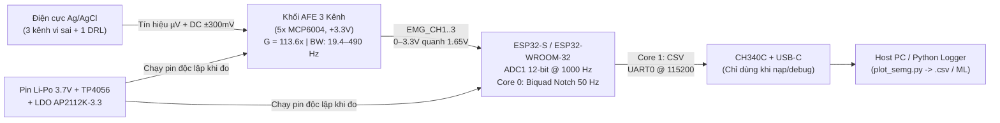
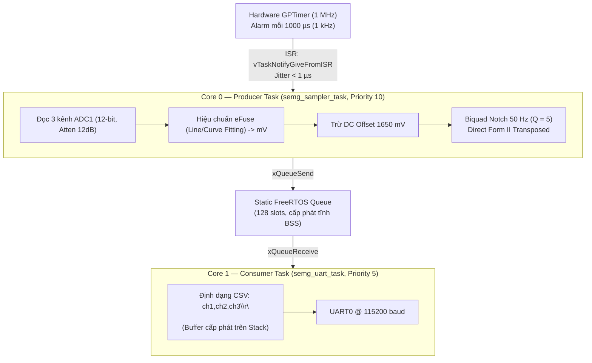

# Tài Liệu Tổng Hợp Kỹ Thuật (Hardware & Firmware) — Hệ Thống Thu Thập Tín Hiệu sEMG 3 Kênh

> **Mục đích tài liệu**: Tài liệu bàn giao (Handoff) đầy đủ thông số kỹ thuật, kiến trúc, số liệu mô phỏng, thiết kế PCB và kiến trúc Firmware của hệ thống sEMG 3 kênh để phục vụ viết **Báo cáo đồ án/nghiên cứu** và **Thiết kế Slide PowerPoint (PPT)**.
> **Nguồn dữ liệu kiểm chứng**: Tổng hợp trực tiếp từ mã nguồn nhánh `main` (`Firmware/main/*`) và nhánh phần cứng `HEAD` (`323848a` — `hardware/*`, `AFE_EMG_3ch.asc`, `README_AFE.md`, `BOM_Mua_Linh_Kien_TheGioiIC.csv`).

---

## 1. Tổng Quan Hệ Thống (System Overview)

- **Tên hệ thống**: Hệ thống thu thập tín hiệu điện cơ bề mặt 3 kênh thời gian thực (**3-Channel Wearable sEMG Data Acquisition System**) phục vụ bài toán nhận dạng cử động bàn tay (`Rest`, `Fist`, `Open hand`, `Pinch` / `Pointing`).
- **Vị trí đặt điện cực giải phẫu trên cẳng tay (Forearm)**:
  - **Kênh 1 (CH1)**: Cơ gấp cổ tay quay (*Flexor Carpi Radialis — FCR*) $\rightarrow$ nhận diện rõ cử động gập/nắm (`Fist`, `Pinch`).
  - **Kênh 2 (CH2)**: Cơ duỗi các ngón (*Extensor Digitorum Communis — EDC*) $\rightarrow$ nhận diện cử động xòe/duỗi tay (`Open hand`).
  - **Kênh 3 (CH3)**: Cơ cánh tay - quay (*Brachioradialis*) $\rightarrow$ bổ trợ phân biệt `Fist`, `Pinch` và xoay cổ tay.
  - **Điện cực tham chiếu (REF / DRL)**: Đặt tại vùng xương ít cơ hoạt động (mỏm khuỷu tay *Olecranon* hoặc mỏm trâm xương trụ cổ tay).
- **Đặc tính tín hiệu sEMG mục tiêu**:
  - Biên độ gốc trên da: **$50\text{ }\mu\text{V} - 5\text{ mV}$**.
  - Phổ tần số có ích: **$20\text{ Hz} - 500\text{ Hz}$** (năng lượng tập trung mạnh nhất ở $50 - 150\text{ Hz}$).
  - Nguồn nhiễu cần triệt tiêu: Điện thế phân cực DC bề mặt da - điện cực ($\pm 200\text{ mV}$ đến $\pm 300\text{ mV}$), nhiễu chuyển động tần số thấp ($< 20\text{ Hz}$), và nhiễu đồng pha lưới điện **$50\text{ Hz}$**.

---

## 2. Phần Cứng: Mạch Tương Tự AFE (Analog Front-End)

### 2.1. Kiến trúc chuỗi xử lý tín hiệu mỗi kênh (Nguồn đơn $+3.3\text{ V}$, $V_{\text{REF}} = 1.65\text{ V}$)

Mạch được thiết kế theo cấu trúc **Buffer + CCIA (Capacitively-Coupled Instrumentation Amplifier) + Active DRL** sử dụng 5 IC Quad Op-Amp **`MCP6004-I/SL`** (SOIC-14, Rail-to-Rail I/O, $GBW = 1\text{ MHz}$, ngõ vào CMOS trở kháng $\sim \text{T}\Omega$).

| Tầng mạch | Cấu trúc & Linh kiện chính | Thông số thiết kế | Vai trò kỹ thuật |
| :--- | :--- | :--- | :--- |
| **Tầng 0: Bảo vệ & Phân cực DC** | `R_IN` = $150\text{ k}\Omega$, `R_B` = $10\text{ M}\Omega \to V_{\text{REF}}$ | $I_{\text{fault}} \le 22\text{ }\mu\text{A}$ | Hạn dòng sự cố qua người đạt chuẩn an toàn y tế IEC 60601-1 ($\le 50\text{ }\mu\text{A}$); neo áp DC khi tuột điện cực. |
| **Tầng 0.5: Đệm trở kháng cao** | 2 Op-Amp Unity-Gain Follower (`E+`, `E−`) | $Z_{\text{in}} \sim \text{T}\Omega$ | Cách ly trở kháng tiếp xúc da, ngăn suy giảm CMRR khi trở kháng 2 cực lệch nhau. |
| **Tầng 1: CCIA ghép tụ** | `C_IN` = $100\text{ nF}$ (1206 C0G 1%), `C_F` = $2.2\text{ nF}$ C0G, `R_F` = $22\text{ M}\Omega$ | $G_1 = 45.45\times$ ($33.15\text{ dB}$) $f_{\text{HP1}} = 3.29\text{ Hz}$ | Khuếch đại vi sai và **chặn hoàn toàn DC offset $\pm 300\text{ mV}$** từ bề mặt da. |
| **Tầng 2: HPF + Khuếch đại** | `C_HP` = $100\text{ nF}$, `R_HP` = $82\text{ k}\Omega$; `R_F` = $15\text{ k}\Omega$, `R_G` = $10\text{ k}\Omega$ | $f_{\text{HP2}} = 19.41\text{ Hz}$ $G_2 = 2.5\times$ ($7.96\text{ dB}$) | Triệt tiêu nhiễu chuyển động (motion artifacts $< 20\text{ Hz}$) và khuếch đại bổ sung. |
| **Tầng 3: Sallen-Key LPF** | `R_L` = $22\text{ k}\Omega \times 2$, `C_L1` = $22\text{ nF}$, `C_L2` = $10\text{ nF}$ | $f_{\text{LPF}} \approx 487.6\text{ Hz}$ ($Q = 0.742$) $G_3 = 1.0\times$ | Lọc thông thấp Butterworth bậc 2 chống chồng phổ (Anti-aliasing) trước ADC $1000\text{ Hz}$. |
| **Đất ảo (`VREF`)** | Cầu chia áp `100 kΩ / 100 kΩ` + tụ `10 µF` ($f_c \approx 0.318\text{ Hz}$) + Buffer `U8A` (có bù In-the-Loop) | $V_{\text{REF}} = 1.65\text{ V}$ | Dịch mức tín hiệu sEMG xoay chiều vào giữa dải $0 - 3.3\text{ V}$ của ADC ESP32. |
| **Mạch DRL chung** | 6 trở `100 kΩ` lấy trung bình `BUFN1..3`, `BUFP1..3` $\to$ Tích phân đảo `U8B` (`1 nF \|\| 10 MΩ`) $\to$ `R69 = 390 kΩ` | Ép nhiễu 50 Hz cơ thể $\sim 45\text{ dB}$ $I_{\text{fault,DRL}} \le 8.46\text{ }\mu\text{A}$ | Bơm tín hiệu đồng pha đảo ngược lại cơ thể qua cực REF để triệt nhiễu lưới điện 50 Hz. |

- **Tổng độ lợi toàn mạch**: $G_{\text{total}} = 45.45 \times 2.5 \approx \mathbf{113.6\times}$ (**$41.1\text{ dB}$**). Lý do không chọn $G = 1000\times$ là để giữ khoảng dự trữ (headroom $\sim 3\times$) quanh $1.65\text{ V}$ khi cơ co mạnh ($\pm 5\text{ mV}_{\text{peak}} \to \pm 568\text{ mV}_{\text{peak}}$), tránh bão hòa rail $3.3\text{ V}$.

### 2.2. Kết quả kiểm chứng mô phỏng LTspice 26.1.1 (`README_AFE.md`)

| Chỉ tiêu kiểm tra | Kết quả mô phỏng | Yêu cầu thiết kế |
| :--- | :--- | :--- |
| **Hệ số khuếch đại (có trở kháng da)** | $41.1\text{ dB}$ ($\approx 113\times$) | $\sim 40\text{ dB}$ |
| **Băng thông $-3\text{ dB}$** | $19.8\text{ Hz} - 511\text{ Hz}$ | $10 - 500\text{ Hz}$ (sEMG) |
| **CMRR @ 50 Hz (Monte Carlo 200 lần, sai số 1%, da lệch $\pm 20\%$)** | Xấu nhất: **$101.6\text{ dB}$**, Trung vị: **$109.9\text{ dB}$** | $> 100\text{ dB}$ |
| **Nhiễu quy đổi đầu vào (IRN, $20 - 500\text{ Hz}$)** | $0.66\text{ }\mu\text{V}_{\text{rms}}$ (AD8608) / $\sim 1.5-2.2\text{ }\mu\text{V}_{\text{rms}}$ (MCP6004) | $\ll 50\text{ }\mu\text{V}$ (và $< 7.1\text{ }\mu\text{V/LSB}$) |
| **Nhiễu 50 Hz ($0.2\text{ V}$ đồng pha $\to$ OUT)** | Xấu nhất: $0.37\text{ mV}_{\text{pp}}$ | $\ll 11\text{ mV}_{\text{pp}}$ (EMG $50\text{ }\mu\text{V}$) |

---

## 3. Phần Cứng: Khối MCU, Nguồn & Thiết Kế PCB Hoàn Chỉnh

### 3.1. Khối Vi điều khiển, Giao tiếp & Nguồn (`BOM_Mua_Linh_Kien_TheGioiIC.csv`, `EMG_Armband_3CH.kicad_sch`)
- **Vi điều khiển (`U3`)**: Module **`ESP32-S Ai-Thinker` (`ESP32-WROOM-32` / ESP32-D0WDQ6)**, đóng gói SMD-38 + pad GND bụng, tích hợp Wi-Fi/BLE và SAR ADC 12-bit.
- **Giao tiếp USB-UART & Nạp code tự động**:
  - Cổng **USB Type-C 16 chân** (`J1`, có 2 trở định danh `R1, R2 = 5.1 kΩ` trên `CC1/CC2`).
  - IC **`CH340C`** (`U9`, SOIC-16, tích hợp dao động nội 12 MHz) + cặp transistor **`MMBT3904`** (`Q1, Q2`) tạo mạch Auto-Reset (DTR/RTS) không cần nhấn nút khi nạp code.
- **Quản lý nguồn & Pin**:
  - Đầu nối pin Li-Po 3.7V (`J2` JST-PH 2P) + công tắc gạt tổng `SW1`.
  - IC sạc tuyến tính **`TP4056`** (`U1`, ESOP-8, `R_PROG = 2.4 kΩ` $\rightarrow$ dòng sạc $\approx 500\text{ mA}$).
  - Bộ ổn áp LDO nhiễu thấp **`AP2112K-3.3`** (`U2`, SOT-23-5, 600 mA, tụ lọc ngõ ra `C4 = 10 µF` đặt sát chân 5).
- **An toàn điện sinh học**: Tuyệt đối rút cáp USB-C khi gắn điện cực lên người (chạy độc lập bằng pin Li-Po để cách ly hoàn toàn khỏi điện lưới).
- **Tổng chi phí BOM dự tính**: **~418.680 VNĐ** (gồm 119 linh kiện trên bo mạch + 1 bịch 50 miếng dán điện cực Snap + 1 bộ 10 dây cáp kẹp).

### 3.2. Thông số Layout PCB & Trạng thái sản xuất (`EMG_Armband_3CH.kicad_pcb`, `.kicad_dru`)
- **Công cụ & Cấu trúc**: Thiết kế trên **KiCad 10.0**, bo mạch **2 lớp đồng** (`F.Cu`, `B.Cu`), phíp FR-4 dày $1.6\text{ mm}$, đồng $1\text{ oz}$.
- **Kỹ thuật chống nhiễu & tối ưu layout đã áp dụng**:
  - **Guard Ring 2 lớp** (`GUARD_VREF_B` trên `B.Cu` và trên `F.Cu`) bọc quanh đầu nối điện cực `J3` và các nút trở kháng cao đầu vào AFE.
  - **Cặp vi sai USB (`USB_DP`/`USB_DN`)** đi 100% trên lớp `F.Cu` không qua via, độ lệch chiều dài (skew) chỉ **$0.38\text{ mm}$** (đạt chuẩn $< 1.0\text{ mm}$).
  - Phủ đồng `GND` 2 lớp kèm **stitching vias**, **teardrops** và loại bỏ hoàn toàn góc nhọn $< 90^\circ$ (tránh acid trap).
  - Chuẩn hóa via gia công JLCPCB/PCBWay (`0.60 mm / 0.30 mm`, annular ring $0.15\text{ mm}$).
- **Kiểm tra & Đóng gói sản xuất**:
  - Chạy `kicad-cli pcb drc`: **0 vi phạm (0 violations), 0 pad chưa đi dây (0 unrouted pads)**.
  - Đã xuất sẵn gói Gerber + Drill sản xuất tại [`hardware/EMG_Armband_3CH_Gerber.zip`](file:///c:/Users/Admin/Documents/IoT/hardware/EMG_Armband_3CH_Gerber.zip).

---

## 4. Phần Mềm Nhúng: Firmware Thu Thập & Xử Lý Tín Hiệu (`ESP-IDF v5.4.2`)

Mã nguồn trên nhánh `main` (`Firmware/main/*`) được thiết kế theo chuẩn **An toàn Hệ thống Nhúng (Zero-malloc Runtime / MISRA-C discipline)** cho chip **ESP32-S (Xtensa Dual-Core LX6)**.

### 4.1. Kiến trúc Dual-Core FreeRTOS & Luồng dữ liệu

### 4.2. Chi tiết kỹ thuật các module Firmware
1. **Định thời chuẩn xác 1 kHz (`semg_adc.c`)**:
   - Dùng **Hardware GPTimer** (`driver/gptimer.h`) đếm ở $1\text{ MHz}$, ngắt alarm mỗi $1000\text{ }\mu\text{s}$ đánh thức task qua `Direct Task Notification` (jitter $< 1\text{ }\mu\text{s}$).
2. **Đọc ADC1 & Hiệu chuẩn eFuse (`semg_adc.c`)**:
   - Đọc `adc_oneshot` trên cụm **ADC1** (an toàn tuyệt đối, không xung đột arbiter với Wi-Fi/BLE như ADC2).
   - Tự động đọc thông số hiệu chuẩn eFuse (`esp_adc/adc_cali.h`) quy đổi giá trị raw $0 - 4095$ sang điện áp thực ($\text{mV}$).
3. **Bộ lọc số DSP Biquad Notch 50 Hz (`semg_filter.c`)**:
   - Triển khai cấu trúc **Direct Form II Transposed** theo công thức *RBJ Audio EQ Cookbook* ($f_s = 1000\text{ Hz}, f_0 = 50\text{ Hz}, Q = 5$, độ rộng dải chắn $\sim 10\text{ Hz}$), triệt nhiễu lưới điện 50 Hz còn sót lại từ cáp.
   - Bật/tắt dễ dàng qua macro `#define ENABLE_DSP_FILTERING (1)` trong `semg_config.h`.
4. **Cấp phát tĩnh 100% (`main.c`)**:
   - Không gọi `malloc`/`free` sau khởi tạo; toàn bộ Stack (`4096` bytes × 2 task) và Queue (`128 × sizeof(semg_sample_t)`) dùng `xTaskCreateStaticPinnedToCore` và `xQueueCreateStatic`.
   - Có vòng lặp monitor mỗi 5 giây báo cáo tốc độ lấy mẫu thực tế (`Rate Hz`), dung lượng trống Queue và số mẫu bị rớt (`Dropped`).
5. **Công cụ trên Host PC (`Firmware/tools/plot_semg.py`)**:
   - Đọc luồng CSV `ch1,ch2,ch3\r\n` qua cổng COM (`115200 baud`), vẽ đồ thị thời gian thực và tự động lưu thành file `semg_capture_<timestamp>.csv` phục vụ huấn luyện mô hình Machine Learning.

### 4.3. Lưu ý đồng bộ Pin Mapping giữa Firmware và PCB thực tế

> [!IMPORTANT]
> Cần lưu ý sự khác biệt nhỏ về chân GPIO giữa code Firmware hiện tại trên nhánh `main` và bản PCB mới nhất trên nhánh phần cứng (tất cả đều thuộc **ADC1** nên đổi chỉ mất 3 dòng code trong `semg_config.h`):
> - **Code Firmware (`main/semg_config.h`)**: CH1 = `GPIO 34` (`ADC1_CH6`), CH2 = `GPIO 35` (`ADC1_CH7`), CH3 = `GPIO 32` (`ADC1_CH4`).
> - **Bản PCB mới nhất (`BOM_Mua_Linh_Kien_TheGioiIC.csv`)**: Dùng cụm ADC1 (`GPIO 36`, `GPIO 39`, `GPIO 34`) và LED trạng thái ở `GPIO 4`. Khi nạp code lên mạch PCB thật, cần cập nhật 3 macro `SEMG_CHx_GPIO` / `SEMG_CHx_ADC_CHANNEL` cho khớp nhau.

---

## 5. Hướng Phát Triển Tương Lai (Future Work — Đưa Vào Slide Kết Luận)

1. **Chuyển đổi sang Vòng tay Điện cực khô dạng Node (Myo-like Segmented Pods)**:
   - Tách bo cứng hiện tại thành **3 Sensor Pods** ($16 \times 26\text{ mm}$, mặt dưới pad đồng mạ vàng ENIG / lò xo tiếp xúc, mặt trên đặt Op-Amp đệm Active Electrode) + **1 Master Pod** nối bằng cáp dẻo FPC trong vỏ in 3D nhựa dẻo TPU.
   - Nâng tầng lọc thông cao HPF lên $20 - 30\text{ Hz}$ và bố trí đường thoát tĩnh điện DC + Guard Ring để chống nhiễu trượt cơ học và lệch trở kháng da ($\Delta Z_e$).
2. **Tích hợp TinyML & Truyền không dây BLE HID**:
   - Trích xuất 4 đặc trưng Hudgins miền thời gian (`MAV/RMS`, `WL`, `ZC`, `SSC`) trên cửa sổ trượt $200\text{ ms}$ (bước nhảy $50\text{ ms}$) và chạy suy luận mô hình phân loại (SVM / MLP / 1D-CNN) trực tiếp trên ESP32, gửi lệnh điều khiển qua BLE.

---

## 6. Gợi Ý Bố Cục Slide PowerPoint (10–12 Slides)

| Slide | Tiêu đề đề xuất | Nội dung trọng tâm & Hình ảnh nên chèn |
| :---: | :--- | :--- |
| **1** | Trang bìa | Tên đề tài, thành viên nhóm, giảng viên hướng dẫn. |
| **2** | Đặt vấn đề & Mục tiêu | Bài toán nhận dạng cử động tay bằng sEMG 3 kênh; vị trí giải phẫu 3 nhóm cơ (`FCR`, `EDC`, `Brachioradialis`) + `DRL`. |
| **3** | Tổng quan kiến trúc hệ thống | Chèn sơ đồ khối tổng thể (Điện cực $\to$ AFE $\to$ ESP32 $\to$ PC/ML) và đặc tính tín hiệu sEMG ($50\text{ }\mu\text{V}-5\text{ mV}$, $20-500\text{ Hz}$). |
| **4** | Thiết kế mạch AFE 3 kênh | Sơ đồ khối 5 tầng (Protection $\to$ Buffer $\to$ CCIA $45.45\times$ $\to$ HPF/Gain $2.5\times$ $\to$ Sallen-Key LPF $490\text{ Hz}$ + Active DRL). |
| **5** | Kết quả mô phỏng LTspice | Bảng thông số đạt được: Gain $41.1\text{ dB}$, BW $19.8-511\text{ Hz}$, CMRR $109.9\text{ dB}$ (Monte Carlo), IRN $0.66\text{ }\mu\text{V}_{\text{rms}}$. |
| **6** | Thiết kế khối Nguồn, MCU & An toàn | ESP32-S + CH340C (USB-C) + TP4056 (Li-Po) + AP2112K-3.3; nhấn mạnh an toàn y tế IEC 60601-1 (chỉ chạy pin khi đo). |
| **7** | Thiết kế PCB & Kiểm chứng DRC | Ảnh SVG/3D mạch PCB (`EMG_Armband_3CH.svg`), Guard Ring 2 lớp, USB diff pair skew $0.38\text{ mm}$, kết quả **0 DRC errors**, sẵn sàng Gerber. |
| **8** | Chi phí linh kiện (BOM) | Tóm tắt bảng BOM ~418k VNĐ cho trọn bộ mạch + 50 điện cực dán + cáp. |
| **9** | Kiến trúc Firmware (ESP-IDF) | Sơ đồ Dual-Core FreeRTOS (Core 0 lấy mẫu 1 kHz + DSP, Core 1 xuất UART), GPTimer jitter $< 1\text{ }\mu\text{s}$, Zero-malloc. |
| **10** | Thuật toán lọc số & Thu thập dữ liệu | Bộ lọc Biquad Notch 50 Hz ($Q=5$) + Hiệu chuẩn ADC eFuse + Demo giao diện/file CSV từ `plot_semg.py`. |
| **11** | Hướng phát triển (Vòng tay Điện cực khô) | Khó khăn khi bỏ gel Ag/AgCl (lệch trở kháng, motion artifacts) & giải pháp chuyển sang kiến trúc Node (Myo-like Pods + TPU). |
| **12** | Kết luận & Q&A | Tổng kết các hạng mục đã hoàn thiện (Mô phỏng, PCB Gerber, Firmware) và cảm ơn. |
