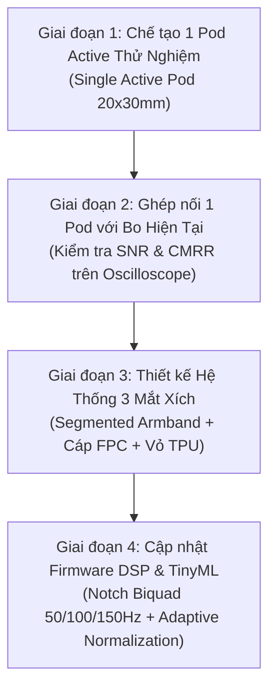

# Báo Cáo Nghiên Cứu Khả Thi: Chuyển Đổi Mạch sEMG Hiện Tại Sang Vòng Đeo Tay Điện Cực Khô (Dry Electrode Armband)

- **Người thực hiện**: Kỹ sư Thiết kế Phần Cứng PCB & AFE (Senior Embedded / AFE Hardware Specialist)
- **Đối tượng khảo sát**: 
  - Mô hình hiện tại trong kho lưu trữ: Hệ thống AFE 3 kênh sEMG dùng 5× `MCP6004` (SOIC-14), linh kiện 0805/1206, kết nối qua cáp bọc giáp (shielded cable) với miếng dán gel Ag/AgCl (`AFE_EMG_3ch.asc`, `hardware/EMG_Armband_3CH.*`, `README_AFE.md`).
  - Tài liệu bàn giao thiết kế đính kèm: *"Thiết Kế Mạch Đo sEMG Từ Op-Amp Rời & Vòng Đeo Tay Điện Cực Khô"* (System Design Document, 6 trang).
- **Vị trí lưu trữ tài liệu**: `reference/semg-armband-dry-electrode-feasibility-research.md`

---

## 1. Tóm Tắt Đánh Giá Tính Khả Thi (Executive Summary & Feasibility Score)

| Hạng mục đánh giá | Điểm khả thi | Kết luận kỹ thuật từ góc nhìn Kỹ sư PCB & AFE |
| :--- | :---: | :--- |
| **Tính khả thi Mạch AFE** | **9.0 / 10** | **Rất khả thi nhưng BẮT BUỘC tái cấu trúc sơ đồ khối**. Cấu trúc chuỗi tín hiệu hiện tại (Buffer $\to$ CCIA $\to$ HPF/Gain $\to$ Sallen-Key LPF $\to$ DRL) hoàn toàn tương thích về mặt giải thuật lọc, nhưng tầng đệm (Unity-Gain Buffer) phải được bóc tách khỏi bo trung tâm để đặt trực tiếp ngay trên lưng pad điện cực (**Active Electrode**). Nếu để đệm ở bo trung tâm và kéo dây từ điện cực khô vào, hệ số nén nhiễu đồng pha (CMRR) sẽ sụp đổ hoàn toàn do trở kháng nguồn cực lớn ($> 1\text{ M}\Omega$). |
| **Tính khả thi Mạch PCB & Form Factor** | **7.5 / 10** | **Khả thi nhưng KHÔNG THỂ dùng bo cứng nguyên khối (Single Rigid PCB)**. Cẳng tay người có dạng hình nón cụt và biến dạng liên tục khi các bắp cơ phồng lên (`Fist`, `Pinch`). Một bo mạch cứng phẳng duy nhất sẽ bị hở khỏi da khi co cơ. Bắt buộc phải chuyển từ kiến trúc bo đơn sang **Kiến trúc Mắt xích Phân tán (Segmented Pods)** nối cáp dẻo (FPC / Ribbon cable), đồng thời thu nhỏ linh kiện từ chuẩn 0805/SOIC-14 xuống 0402/0603 và TSSOP/DFN/SOT-23. |
| **Giao diện Điện cực Khô (Dry Interface)** | **8.0 / 10** | **Khả thi nhưng phát sinh 5 rào cản vật lý y sinh khắt khe** so với miếng dán gel Ag/AgCl: Lệch trở kháng da ($\Delta Z_e$), trôi điện thế phân cực DC ($\pm 300\text{ mV}$), nhiễu trượt cơ học (Motion Artifacts), tích điện tĩnh trên cổng MOSFET, và hiện tượng "thời gian làm nóng" (Warm-up time) do mồ hôi vi lượng. |

---

## 2. Đối Chiếu Toàn Diện: Mô Hình Hiện Tại vs. Vòng Tay Điện Cực Khô

Bảng so sánh chi tiết giữa cấu trúc hiện tại trong repo và mô hình vòng tay mục tiêu:

| Tiêu chí kỹ thuật | Mô hình hiện tại trong Repo (`feat/afe-mcp6004-pcb`) | Mô hình Vòng tay Điện cực Khô (Mục tiêu) | Đánh giá & Yêu cầu thay đổi phần cứng |
| :--- | :--- | :--- | :--- |
| **Loại điện cực** | Miếng dán gel ướt **Ag/AgCl** (Disposable Wet Gel Pads). | Điện cực khô **ENIG Gold-Plated** tích hợp trên PCB hoặc đệm kim loại đàn hồi (Spring Finger / Dome). | Chuyển từ tiếp xúc thuần trở thấp ($\sim 5-10\text{ k}\Omega$) sang tiếp xúc điện dung nối tiếp trở kháng cao ($\sim 100\text{ k}\Omega - 5\text{ M}\Omega$). |
| **Vị trí Op-Amp Buffer** | Nằm trên bo mạch chính (`U4A/B, U5A/B, U6A/B` - `MCP6004` SOIC-14). | Đặt ngay tại mặt sau của từng Pad điện cực (**Active Electrode Architecture**). | **Thay đổi bắt buộc**: Di chuyển Op-Amp đệm ra các mắt xích (Pods) tiếp xúc trực tiếp với da. |
| **Đường truyền tín hiệu đầu vào** | Cáp bọc giáp 7 lõi (Shielded Cable) dài $\sim 0.5 - 1\text{ m}$ cắm vào header `J3`. | Chiều dài vết mạch từ pad tới chân Op-Amp $\approx 0\text{ mm}$ (via xuyên tầng). | Loại bỏ hoàn toàn cáp dài; triệt tiêu tới 80% nhiễu cảm ứng điện từ 50 Hz và nhiễu rung lắc cáp (Cable Sway Artifacts). |
| **Tần số cắt HPF ($f_c$)** | Tầng CCIA: $3.29\text{ Hz}$ ($C_F = 2.2\text{ nF}, R_F = 22\text{ M}\Omega$). Tầng 2: $19.41\text{ Hz}$ ($C = 100\text{ nF}, R = 82\text{ k}\Omega$). | Đẩy toàn bộ dải cắt tần số thấp lên **$20\text{ Hz} - 30\text{ Hz}$** ngay từ tầng đầu hoặc tầng lọc tích cực bậc 2. | Điện cực khô sinh ra nhiễu trượt cơ học (Motion Artifacts) rất mạnh ở $1-15\text{ Hz}$; dải cắt $3.3\text{ Hz}$ sẽ làm bão hòa điện áp tầng sau. |
| **Kiến trúc cơ khí & Bo mạch** | 1 Bo mạch cứng FR4 phẳng (Monolithic Rigid PCB 2 lớp), kích thước linh kiện 0805, 1206. | Chuỗi **3 – 8 mắt xích (Pods)** nhỏ nối cáp dẻo FPC / silicon dẻo quanh cẳng tay, lồng vỏ in 3D nhựa dẻo TPU. | Tách bo: Mỗi Pod chứa 1 kênh đo (~$15\times 25\text{ mm}$), bo trung tâm chứa ESP32-S3, nguồn sạc và xử lý dữ liệu. |
| **Đóng gói linh kiện** | IC SOIC-14, trở tụ SMD 0805 / 1206. | IC TSSOP-14, MSOP-8, DFN hoặc SOT-23; trở tụ SMD 0402 / 0603. | Thu nhỏ diện tích bo mạch xuống $60\% - 75\%$ để vừa vặn trong các mắt xích đeo tay. |

---

## 3. Phân Tích Tính Khả Thi Mạch AFE (Analog Front-End)

### 3.1. Tại sao bắt buộc phải chuyển sang kiến trúc Active Electrode?
Trong mô hình hiện tại, tín hiệu vi sai từ da truyền qua dây dẫn dài trước khi vào ngõ vào của `MCP6004`. Với điện cực Ag/AgCl có gel dẫn điện, trở kháng tiếp xúc da chỉ khoảng $2\text{ k}\Omega - 10\text{ k}\Omega$, điện dung ký sinh của dây bọc giáp ($\sim 100\text{ pF/m}$) chỉ tạo tần số cắt cực cao ngoài dải đo.
Tuy nhiên, khi dùng điện cực khô mạ vàng ENIG:
1. Trở kháng tiếp xúc da – đồng ($Z_e$) vọt lên mức **$100\text{ k}\Omega - 5\text{ M}\Omega$** do lớp sừng khô (*Stratum Corneum*).
2. Sự bất đối xứng trở kháng giữa hai cực $\Delta Z_e = |Z_{e1} - Z_{e2}|$ có thể lên tới hàng trăm $\text{k}\Omega$.
3. Theo nghiên cứu của Chi et al. (2010), hệ số nén nhiễu đồng pha suy giảm theo công thức:
   $$\text{CMRR}_{\text{system}} \approx \frac{Z_{\text{in\_opamp}}}{\Delta Z_e}$$
   Nếu dùng cáp nối dài, điện dung ký sinh của cáp ($C_{\text{cable}} \approx 100\text{ pF}$) sẽ làm giảm trở kháng đầu vào $Z_{\text{in}}$ ở tần số $50\text{ Hz}$:
   $$|Z_{C}| = \frac{1}{2\pi \cdot 50\text{ Hz} \cdot 100\text{ pF}} \approx 31.8\text{ M}\Omega$$
   Khi đó, với $\Delta Z_e = 500\text{ k}\Omega$, $\text{CMRR}_{\text{system}}$ tụt dốc xuống chỉ còn:
   $$\text{CMRR} \approx \frac{31.8\text{ M}\Omega}{0.5\text{ M}\Omega} \approx 63.6 \approx 36\text{ dB}$$
   Mức CMRR $36\text{ dB}$ này sẽ biến toàn bộ nhiễu đồng pha $50\text{ Hz}$ từ điện lưới trong phòng thành tín hiệu vi sai giả mạo, làm bão hòa hoàn toàn ngõ ra AFE!
4. **Giải pháp AFE**: Đặt 2 Op-Amp mắc kiểu Unity-Gain Voltage Follower ngay tại mặt Top của PCB, chỉ cách pad điện cực khô ở mặt Bottom một lỗ via xuyên tầng ($< 1.6\text{ mm}$). Trở kháng vào của Op-Amp CMOS ($Z_{\text{in}} > 10^{12}\ \Omega \parallel 1\text{ pF}$) lập tức biến đổi trở kháng nguồn từ $5\text{ M}\Omega$ xuống chỉ còn vài $\Omega$ ở ngõ ra đệm, triệt tiêu hoàn toàn tác động của $\Delta Z_e$ và điện dung đường truyền.

### 3.2. Đường hồi tiếp phân cực DC (DC Bias Return Path)
- Cổng vào của Op-Amp CMOS (`MCP6004` hoặc `AD8605`) được cách ly hoàn toàn bởi lớp điện môi $SiO_2$, với dòng phân cực ngõ vào (Input Bias Current) siêu nhỏ ($I_B < 1\text{ pA}$).
- Điện cực khô hoạt động như một tụ điện ghép nối tiếp với da. Nếu không có đường dẫn DC, chân ngõ vào sẽ bị "lơ lửng" (floating). Hiện tượng tích điện tĩnh từ da hoặc ma sát quần áo (triboelectric charge) sẽ nạp dần vào điện dung cổng, làm điện áp ngõ vào trôi dần về phía $V_{DD}$ hoặc $GND$, đẩy Op-Amp vào trạng thái bão hòa (rail saturation).
- **Yêu cầu thiết kế**: Mạch hiện tại đã có cụm $R_B = 10\text{ M}\Omega$ nối về $V_{\text{REF}} = 1.65\text{ V}$. Đây là điểm cộng lớn. Tuy nhiên, khi dùng điện cực khô siêu cao trở, giá trị $R_B$ nên được nâng lên mức **$22\text{ M}\Omega - 100\text{ M}\Omega$** để tránh làm suy giảm trở kháng vào tổng thể của mạch đệm.

### 3.3. Phân bổ hệ số khuếch đại (Gain Budgeting) & Cắt nhiễu trượt (Motion Artifacts)
- Điện thế phân cực tiếp xúc (Half-cell potential) giữa kim loại mạ vàng và mồ hôi da dao động từ $\pm 100\text{ mV}$ đến $\pm 300\text{ mV}$.
- Tầng khuếch đại vi sai đầu tiên (dù là CCIA hay In-Amp) bắt buộc phải giữ độ lợi thấp:
  - Nếu dùng CCIA như hiện tại: $G_1 = 45.45\times$ là khả thi vì tầng này ghép tụ AC ($C_{\text{IN}} = 100\text{ nF}$ C0G), chặn đứng hoàn toàn áp DC offset $\pm 300\text{ mV}$.
  - Nếu dùng In-Amp 3-Op-Amp truyền thống (theo gợi ý trong PDF): Bắt buộc $G_1 \le 5 - 10\times$. Nếu để $G_1 = 100\times$, điện áp $\pm 300\text{ mV} \times 100 = \pm 30\text{ V}$ sẽ chạm nguồn $+3.3\text{ V}$ ngay tức thì.
- **Tần số cắt bộ lọc thông cao (HPF)**:
  - Trong tài liệu De Luca et al. (2010), năng lượng nhiễu trượt cơ học do điện cực khô cọ xát trên da tập trung mạnh nhất từ $1\text{ Hz}$ đến $15\text{ Hz}$.
  - Tần số cắt HPF hiện tại của tầng CCIA ($3.29\text{ Hz}$) là quá thấp đối với điện cực khô. Cần nâng tần số cắt của tầng lọc thông cao bậc 2 (Sallen-Key HPF) lên **$20\text{ Hz} - 30\text{ Hz}$** với hệ số phẩm chất $Q = 0.707$ (Butterworth) để triệt tiêu triệt để các xung gai nhiễu cơ học trước khi đưa vào ADC.

### 3.4. Điện cực tham chiếu & Mạch phản hồi chủ động DRL (Driven Right Leg)
- Trong mô hình Ag/AgCl dán rời, điện cực REF/DRL thường được kéo dây dán ra mỏm khuỷu tay (*Olecranon*) – nơi chỉ có xương và không có cơ hoạt động.
- Trên vòng đeo tay (Armband), tất cả các điện cực đều nằm trên chu vi cẳng tay. Điện cực DRL sẽ tiếp xúc trực tiếp với da cẳng tay.
- Mạch Active DRL hiện tại (lấy trung bình tín hiệu từ 6 bộ đệm, khuếch đại tích phân đảo pha qua $U8B$ rồi bơm ngược lại cơ thể qua $R_{69} = 390\text{ k}\Omega$) hoàn toàn khả thi trên vòng tay. Tuy nhiên:
  - Điện cực DRL cũng phải dùng điện cực khô mạ vàng ENIG có diện tích lớn gấp đôi điện cực đo (ví dụ: $10\times 20\text{ mm}$) để hạ thấp trở kháng tiếp xúc, giúp mạch DRL "ghìm" điện áp đồng pha của cơ thể về mức $V_{\text{REF}} = 1.65\text{ V}$ hiệu quả nhất.

---

## 4. Phân Tích Tính Khả Thi Mạch PCB & Cơ Khí Đóng Gói (PCB Layout & Mechanical Integration)

### 4.1. Tại sao Bo Mạch Cứng Đơn Khối (Single Rigid PCB) Thất Bại Trên Vòng Tay?
1. **Hình học giải phẫu cẳng tay**: Cẳng tay người không phải là hình trụ tròn hoàn hảo mà có dạng elip thuôn nhọn (hình nón cụt). Khi đeo một thanh PCB FR4 cứng thẳng tắp, các mép của điện cực sẽ bị kênh lên, diện tích tiếp xúc thực tế với da bị suy giảm nghiêm trọng.
2. **Biến dạng cơ bắp động (Dynamic Muscle Bulging)**: Khi người dùng thực hiện các cử chỉ co gập (`Fist`, `Pinch`), nhóm cơ gấp cẳng tay (*Flexor Carpi Radialis*) sẽ căng phồng lên theo phương xuyên tâm. Sự phồng cơ này sẽ đẩy bo mạch cứng ra xa khỏi bề mặt da ở các vị trí lân cận $\to$ mất tiếp xúc điện cực khô, sinh ra xung nhiễu bão hòa (Motion Artifact Clipping).
3. **Kết luận kỹ thuật**: **Khả thi về mặt sản phẩm CHỈ ĐẠT ĐƯỢC khi sử dụng Kiến trúc Mắt xích Độc lập (Segmented Pods)** tương tự thiết kế thương mại nổi tiếng *Thalmic Labs Myo Armband*.

```
   ┌─────────────────────────────────────────────────────────────┐
   │               MÔ HÌNH VÒNG TAY PHÂN TÁN (SEGMENTED PODS)    │
   └─────────────────────────────────────────────────────────────┘

       [ Pod 1: CH1 ] ──FPC/Ribbon── [ Pod 2: CH2 ] ──FPC/Ribbon── [ Pod 3: CH3 ]
       (Cơ FCR - Nắm)                (Cơ EDC - Xòe)                (Cơ Brachio)
             │                             │                             │
             └──────────────────────┬──────┴─────────────────────────────┘
                                    │
                                    ▼
                      ┌───────────────────────────┐
                      │    Bo Trung Tâm (Master)  │
                      │  - ESP32-S3 (BLE/TinyML)  │
                      │  - TP4056 + Li-Po 500mAh  │
                      │  - LDO Ultra-low noise    │
                      │  - DRL Master + REF Pad   │
                      └───────────────────────────┘
```

### 4.2. Kiến Trúc Mắt Xích Phân Tán (Segmented Active Pods)
- **Mỗi Pod đo (3 Pods cho 3 kênh)**:
  - Kích thước mạch: Khoảng **$18\text{ mm} \times 28\text{ mm}$**, phíp FR4 2 lớp (hoặc 4 lớp), độ dày $1.0\text{ mm} - 1.2\text{ mm}$.
  - **Mặt Bottom (tiếp xúc da)**: 2 Pad đồng mạ vàng **ENIG** trần (không phủ Solder Mask). Kích thước mỗi pad $6\text{ mm} \times 12\text{ mm}$ (bo tròn 4 góc). Khoảng cách tâm-đến-tâm (IED - Inter-Electrode Distance) đặt chuẩn **$18\text{ mm}$** dọc theo chiều sợi cơ cẳng tay (tuân thủ khuyến nghị SENIAM và De Luca).
  - **Mặt Top (linh kiện)**: Chứa 2 Op-Amp Buffer (dùng IC Dual Op-Amp như `MCP6002`, `AD8606`, hoặc `OPA2333` gói VSSOP-8 / DFN-8), các điện trở phân cực $R_B = 22\text{ M}\Omega$ và tụ bảo vệ ESD.
  - **Kết nối liên mắt xích**: Đầu nối cáp dẻo FPC 0.5mm pitch (hoặc hàn trực tiếp sợi cáp mềm dẻo 4 dây bọc teflon: `+3V3`, `GND`, `VREF`, `OUT_BUF1`, `OUT_BUF2`).
- **Bo Trung Tâm (Master Pod)**:
  - Đặt ở mặt mu cẳng tay (vùng ít cơ cử động).
  - Chứa module `ESP32-S3-WROOM-1`, IC sạc `TP4056`, cổng sạc USB-C, LDO `AP2112K-3.3` (hoặc `LP5907`), tầng khuếch đại chính CCIA, các bộ lọc Sallen-Key LPF và mạch DRL.
  - Mặt Bottom của Bo Master chứa 1 Pad lớn mạ vàng ENIG làm cực **DRL (REF)** tiếp xúc với bề mặt xương cẳng tay.

### 4.3. Quy Tắc Layout PCB Bắt Buộc Cho Tầng Active Electrode Khô
1. **CẤM ĐỔ ĐỒNG GND DƯỚI PAD ĐIỆN CỰC**:
   - Dưới mặt đối diện của 2 pad điện cực ở mặt Bottom, tuyệt đối mở cửa sổ khoét đồng (Keep-out zone) ở tất cả các lớp trong và lớp Top.
   - *Lý do*: Lớp đồng GND đối diện sẽ tạo thành một tụ điện phẳng ký sinh $C_{\text{parasitic}} \approx \frac{\varepsilon_0 \varepsilon_r A}{d}$. Với phíp FR4 dày $1.6\text{ mm}$ ($\varepsilon_r \approx 4.5$), pad $6\times 12\text{ mm}$ sẽ tạo tụ ký sinh $\sim 2 - 5\text{ pF}$. Tụ này nối song song ngõ vào xuống GND sẽ làm sụt giảm nghiêm trọng trở kháng đầu vào $Z_{\text{in}}$ ở tần số cao, phá hủy tính năng của Active Buffer!
2. **VÒNG ĐỒNG BẢO VỆ (GUARD RING)**:
   - Bao quanh toàn bộ đường mạch từ Pad điện cực vào chân vào của Op-Amp bằng một đường mạch bao quanh (Guard Trace).
   - Vòng Guard này **không nối xuống GND** mà nối thẳng vào **ngõ ra của Op-Amp Buffer** (hoặc áp $V_{\text{REF}}$).
   - *Ý nghĩa*: Vì ngõ ra của Buffer có cùng điện thế xoay chiều với ngõ vào ($V_{\text{out}} \approx V_{\text{in}}$), độ chênh lệch điện áp giữa vòng Guard và đường tín hiệu bằng 0 ($\Delta V = 0\text{ V}$). Do đó, dòng điện rò bề mặt do mồ hôi, ẩm độ không khí qua bề mặt phíp FR4 bị triệt tiêu hoàn toàn ($I_{\text{leak}} = \frac{\Delta V}{R_{\text{surface}}} = 0$).
3. **TIẾP ĐIỂM NÂNG CAO (RAISED CONTACTS)**:
   - Thay vì để pad phẳng lỳ ngang với bề mặt PCB, giải pháp thực chiến là hàn các chân tiếp xúc đàn hồi mạ vàng (**SMD Spring Fingers** hoặc **Gold Domes**) cao từ **$0.5\text{ mm} - 1.0\text{ mm}$** lên trên pad đồng ENIG.
   - Chân lò xo này vừa giúp xuyên qua lớp lông tay mỏng, vừa duy trì lực tì đè đàn hồi liên tục lên da kể cả khi bắp cơ co duỗi làm thay đổi đường kính cánh tay.

---

## 5. Năm Thách Thức Vật Lý Cốt Lõi Khi Chuyển Từ Ag/AgCl Sang Điện Cực Khô

```
  ┌────────────────────────────────────────────────────────────────────────┐
  │         5 BÀI TOÁN KỸ THUẬT QUYẾT ĐỊNH SỰ THÀNH BẠI CỦA MẠCH           │
  └────────────────────────────────────────────────────────────────────────┘
  1. Lệch trở kháng da (ΔZe) ───► Mất cân bằng CMRR 50Hz ──► Cần Active Buffer (Zin > 1 TΩ)
  2. Bão hòa DC (±300mV) ──────► Trôi áp lơ lửng ngõ vào ──► Cần Trở xả DC (RB 10M - 100MΩ)
  3. Mất cân bằng trở tầng trừ ──► Suy giảm triệt nhiễu ────► Dùng trở sai số 0.1% + Mạch DRL
  4. Nhiễu trượt cơ học (1-15Hz) ─► Gai áp khi co cơ ───────► Nâng HPF lên 20-30Hz + Pad lồi
  5. Nhiễu nguồn xung số/RF ─────► Gợn áp ESP32 sang AFE ───► Tách LDO Low-noise + Pin Li-Po
```

### 5.1. Thách thức 1: Suy giảm nghiêm trọng CMRR do bất đối xứng trở kháng da ($\Delta Z_e$)
- **Miếng dán Ag/AgCl**: Gel dẫn điện làm ướt lớp sừng (*Stratum Corneum*), biến đổi ion thành dòng điện tích cực kỳ mượt mà. Trở kháng tiếp xúc thấp và rất cân bằng: $Z_{e1} \approx 5\text{ k}\Omega, Z_{e2} \approx 5.5\text{ k}\Omega \implies \Delta Z_e \approx 500\ \Omega$.
- **Điện cực khô**: Tiếp xúc kim loại - da khô qua lớp sừng dày cách điện. Trở kháng biến thiên khủng khiếp từ $200\text{ k}\Omega$ đến $5\text{ M}\Omega$ tùy cơ địa từng người. Độ chênh lệch $\Delta Z_e$ giữa 2 điểm cách nhau $2\text{ cm}$ dễ dàng vượt quá $500\text{ k}\Omega - 1\text{ M}\Omega$.
- **Hậu quả**: Hiện tượng phân áp (Potential Divider Effect) biến nhiễu điện trường $50\text{ Hz}$ trong không gian thành tín hiệu vi sai đầu vào, lớn gấp $20 - 30$ lần tín hiệu sEMG có ích ($50\text{ }\mu\text{V} - 2\text{ mV}$).
- **Giải pháp**: Bắt buộc dùng Op-Amp CMOS/JFET có trở kháng cực đại ($Z_{\text{in}} > 10^{12}\ \Omega$) mắc đệm ngay tại pad, kết hợp mạch hồi tiếp DRL đảo pha $50\text{ Hz}$ từ cơ thể.

### 5.2. Thách thức 2: Nhiễu trượt cơ học (Motion Artifacts) & Biến dạng tiếp xúc
- **Cơ chế vật lý**: Ở giao diện kim loại - da tồn tại một lớp điện tích kép (Electrical Double Layer). Khi người dùng cử động tay, lực ma sát làm điện cực xê dịch cơ học trên da, làm xáo trộn lớp điện tích này và sinh ra một xung điện thế biến thiên (Half-cell fluctuation) biên độ lên tới **$\pm 50\text{ mV} - \pm 200\text{ mV}$** trong dải tần số thấp $1\text{ Hz} - 15\text{ Hz}$.
- **Hậu quả**: Với tổng độ lợi của mạch AFE $G \approx 113 - 1000\times$, xung nhiễu này sẽ đẩy ngõ ra Op-Amp đập thẳng vào đường nguồn $+3.3\text{ V}$ hoặc $0\text{ V}$ (Saturating/Clipping), làm mất hoàn toàn tín hiệu EMG trong hàng trăm mili-giây.
- **Giải pháp**:
  - Tăng tần số cắt của bộ lọc thông cao lên **$f_c \ge 20\text{ Hz} - 30\text{ Hz}$** (cắt sạch toàn bộ phổ $1-15\text{ Hz}$).
  - Gia cố lực ép cơ khí bằng dây đeo đàn hồi (Elastic band) và dùng tiếp điểm nhô cao (Gold Dome / Spring Finger) để giữ điểm tiếp xúc cố định vào da.

### 5.3. Thách thức 3: Hiệu ứng "Thời gian khởi động làm nóng" do mồ hôi vi lượng (Sweat / Warm-up Effect)
- **Thực nghiệm y sinh (Searle & Kirkup, 2000)**: Khi mới đeo vòng tay điện cực khô trong 5 – 10 phút đầu, người dùng sẽ thấy tín hiệu rất nhiều nhiễu và biên độ không ổn định.
- **Nguyên nhân**: Lúc đầu da hoàn toàn khô ($Z_e > 2\text{ M}\Omega$). Sau $10 - 15$ phút đeo, da bên dưới bề mặt kín của pad điện cực bắt đầu tiết mồ hôi vi lượng tự nhiên (chứa ion $Na^+, Cl^-$). Lớp ẩm mỏng này đóng vai trò như một chất điện phân tự nhiên, kéo trở kháng $Z_e$ giảm dần từ $2\text{ M}\Omega$ xuống chỉ còn vài trăm $\text{k}\Omega$, đồng thời điện thế DC Half-cell trôi dần (dynamic baseline drift).
- **Giải pháp**:
  - Mạch AFE cần có thời gian tự ổn định điểm làm việc (DC settling).
  - Thuật toán trích xuất đặc trưng (RMS, MAV) hoặc mô hình TinyML trên ESP32 phải chuẩn hóa tín hiệu (Z-score normalization / Adaptive Gain Control) để không bị nhận diện sai cử chỉ giữa lúc mới đeo và lúc đã đeo lâu.

### 5.4. Thách thức 4: Bão hòa DC & Tích tụ tĩnh điện (ESD Protection) trên ngõ vào CMOS
- Op-Amp CMOS có dòng rò ngõ vào mức pA ($< 1\text{ pA}$). Nếu cổng vào bị ngắt DC hoàn toàn bởi điện cực khô, các điện tích tĩnh điện (do ma sát cơ học giữa vòng tay và da) không có đường tiêu tán sẽ tích tụ trên cổng MOSFET.
- Áp tĩnh điện này có thể lên tới vài Volt đến vài chục Volt, không những làm bão hòa ngõ ra AFE vĩnh viễn mà còn có nguy cơ đánh thủng lớp cách điện oxide mỏng của chân IC (ESD damage).
- **Giải pháp**:
  - Mắc điện trở rò DC $R_B = 10\text{ M}\Omega - 22\text{ M}\Omega$ từ ngõ vào về điểm chuẩn $V_{\text{REF}} = 1.65\text{ V}$.
  - Bố trí diode bảo vệ ESD kép siêu rò thấp (Ultra-low leakage diode array như `BAV199`, dòng rò $I_R < 5\text{ pA}$) tại ngõ vào trước chân Op-Amp.

### 5.5. Thách thức 5: Nhiễu xuyên kênh từ bộ nguồn số (Digital Switching & RF Coupling)
- Trên vòng đeo tay nhỏ gọn, module `ESP32-S3-WROOM-1` nằm cách mạch analog chỉ vài centimet. Khi bộ đệm Wi-Fi hoặc BLE phát xung vô tuyến, dòng tiêu thụ nhảy vọt từ $30\text{ mA}$ lên đỉnh $300\text{ mA} - 450\text{ mA}$ trong vài micro-giây, tạo các gợn sóng nhấp nhô (ripple) trên đường nguồn.
- Trong khi đó, tín hiệu sEMG ở đầu vào có biên độ chỉ **$50\text{ }\mu\text{V}$**. Bất kỳ gợn nguồn nào lọt qua chân nguồn $V_{DD}$ hoặc điểm phân áp $V_{\text{REF}}$ của Op-Amp đều sẽ bị khuếch đại thành xung nhiễu giả mạo.
- **Giải pháp**:
  - Tuyệt đối không dùng chung LDO giữa ESP32 và khối Analog.
  - Dùng 1 LDO riêng biệt có chỉ số triệt nhiễu nguồn cực cao (High-PSRR, Ultra-Low Noise) như `LP5907` hoặc `TPS7A05` (nhiễu ngõ ra $< 10\text{ }\mu\text{V}_{\text{rms}}$) chỉ để cấp riêng cho 5 IC Op-Amp analog.
  - Tách mặt mass tương tự (`AGND`) và mass số (`DGND`) nối chung tại 1 điểm duy nhất (Star Ground / Net-Tie) cạnh đầu ra của LDO.

---

## 6. Lộ Trình Chuyển Đổi Kỹ Thuật Khuyến Nghị (Migration Roadmap)

Để chuyển đổi thành công từ bo mạch hiện tại trên nhánh `feat/afe-mcp6004-pcb` sang vòng tay điện cực khô mà không chịu rủi ro thất bại phần cứng:



1. **Bước 1 — Giữ nguyên bo mạch chính hiện tại, làm 1 bo con Active Pod nhỏ**:
   - Thiết kế một bo nhỏ kích thước $20\text{ mm} \times 30\text{ mm}$, mặt dưới có 2 pad mạ vàng ENIG ($6\times 12\text{ mm}$), mặt trên gắn 1 IC Dual Op-Amp `MCP6002` (hoặc `AD8606`) làm đệm và 2 trở $R_B = 22\text{ M}\Omega$ về $V_{\text{REF}}$.
   - Nối ngõ ra của Pod thử nghiệm này về cổng `J3` của bo AFE hiện tại bằng 4 sợi dây mềm.
   - Buộc thun lên cơ cẳng tay, đo sóng trên Oscilloscope khi co cơ `Fist` để kiểm chứng biên độ và mức độ khử nhiễu $50\text{ Hz}$.
2. **Bước 2 — Thu nhỏ linh kiện cho thiết kế hoàn chỉnh**:
   - Thay đổi BOM: Chuyển toàn bộ trở tụ từ 0805 xuống **0402 hoặc 0603**.
   - Thay 5 IC `MCP6004` (SOIC-14 to cồng kềnh) bằng các IC Op-Amp gói nhỏ hơn như **TSSOP-14** (cho bo trung tâm) và **VSSOP-8 / DFN** (cho các Pods).
3. **Bước 3 — Đóng gói cơ khí in 3D nhựa TPU dẻo**:
   - Thiết kế khớp xâu chuỗi (Chain-link segments) cho phép các Pods uốn lượn ôm sát theo chu vi cánh tay người dùng.
   - Bổ sung chân tiếp xúc lò xo mạ vàng nhô cao $0.5\text{ mm}$ trên các pad đồng để đảm bảo áp lực tiếp xúc đồng đều.
4. **Bước 4 — Nâng cấp Firmware DSP**:
   - Thêm bộ lọc số Cascaded Biquad IIR Notch lọc triệt để hài $50\text{ Hz}$, $100\text{ Hz}$, $150\text{ Hz}$.
   - Cài đặt thuật toán chuẩn hóa biên độ động thích ứng với sự thay đổi của lớp mồ hôi sau 15 phút đeo.

---

## 7. Tài Liệu Tham Khảo Kỹ Thuật (Primary Citations)

1. **Chi, Y. M., Jung, T.-P., & Cauwenberghs, G. (2010)**. *Dry-contact and noncontact biopotential electrodes: Methodological review*. IEEE Reviews in Biomedical Engineering, 3, 106–119. (Mô hình mạch tương đương da - điện cực khô, phương trình suy giảm CMRR và thiết kế đường thoát dòng phân cực DC $10\text{ M}\Omega - 100\text{ M}\Omega$).
2. **Searle, A., & Kirkup, L. (2000)**. *A direct comparison of wet, dry and insulating bioelectric recording electrodes*. Physiological Measurement, 21(2), 271–283. (Thực nghiệm so sánh điện cực khô kết hợp Active Buffer với điện cực ướt Ag/AgCl và hiệu ứng lớp mồ hôi theo thời gian).
3. **De Luca, C. J., Gilmore, L. D., Kuznetsov, M., & Roy, S. H. (2010)**. *Filtering the surface EMG signal: Movement artifact and baseline noise contamination*. Journal of Biomechanics, 43(8), 1573–1579. (Cơ sở chọn tần số cắt bộ lọc thông cao $20\text{ Hz} - 30\text{ Hz}$ để khử nhiễu trượt cơ học cho sEMG).
4. **Kitchin, C., & Counts, L. (2006)**. *A Designer's Guide to Instrumentation Amplifiers (3rd ed.)*. Analog Devices. (Thiết kế tầng In-Amp, ảnh hưởng của sai số trở tới CMRR và kỹ thuật Guard Ring).
5. **Webster, J. G. (2009)**. *Medical Instrumentation: Application and Design (4th ed.)*. John Wiley & Sons. (Cơ sở phân tích điện thế Half-cell và mạch phản hồi DRL).
